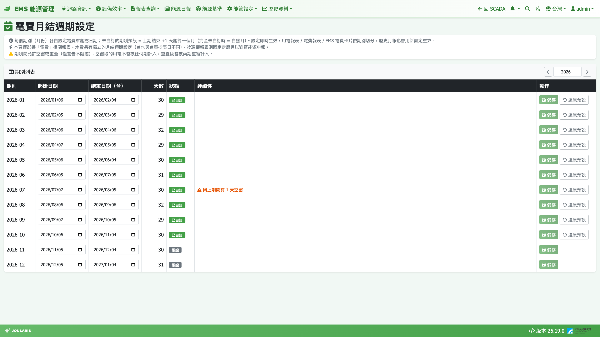
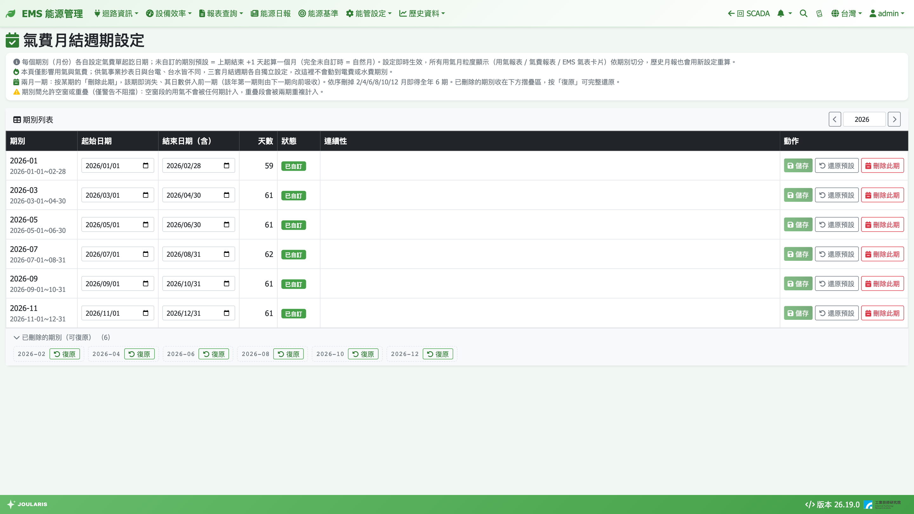

# 月結週期（電 / 水 / 氣）

實務上，電費單、水費單、瓦斯費單的結算週期通常**不是每月 1 日起算**，而且每期抄表日會浮動（例如 6 月期 = 6/16～7/17、7 月期 = 7/18～8/16）。月結週期設定讓您把每一期的**起訖日期**照帳單填入，報表「月」的切法就會和帳單對得上。

系統有三套月結週期，彼此**完全獨立**：

| 設定頁 | 選單路徑 | 影響範圍 |
|--------|----------|----------|
| **電費月結週期設定** | **能管設定 → 電表 → 電費月結週期** | 用電報表、電費報表、EMS 電費相關卡片與主要電表月 / 日圖 |
| **水費月結週期設定** | **能管設定 → 自來水表 → 水費月結週期** | 用水報表、水費報表、EMS 用水 / 水費卡片 |
| **氣費月結週期設定** | **能管設定 → 氣表 → 氣費月結週期** | 用氣報表、氣費報表、EMS 用氣 / 氣費卡片 |

台電、台水、供氣事業的抄表日各不相同，所以分開設定；改任何一套都不會影響另外兩套。

## 哪些報表不走月結週期？

以下報表的「月」**固定是曆月**（每月 1 日到月底），不受任何月結週期影響：

- [冷凍噸報表](refrigeration-ton)與空調水系統迴路資訊
- [能源申報](energy-declaration)、[空壓機能源申報](air-compressor-declaration)
- [能源基準](energy-baseline)
- [設備效率診斷](equipment-efficiency)

另外，所有報表的**「年」一律是自然年**（1/1～12/31），不隨期別偏移。

> 💡 提示：因此同一個月份，用電報表（期別）與能源申報（曆月）的度數可能不同，這是刻意的設計，不是錯誤。

## 預設規則

- **完全沒有自訂過**：每期 = 自然月（1 日～月底），報表月份標籤維持 `yyyy-MM`
- **自訂過某一期**：其後沒有自訂的期別，會自動接續 —— 起始 = 上期結束 +1 天，長度一個月
- 期別編號 = 起始日所在月份（台電慣例）
- 只要有自訂，報表月份會顯示完整區間，例如 `2026-06-16~07-17`

## 畫面說明

- 上方：年份輸入框與左右箭頭，切換要設定的年份
- **期別列表**：每期一列，欄位為 **期別**、**起始日期**、**結束日期（含）**、**天數**、**狀態**（**預設** / **已自訂**）、**連續性**、**動作**
- **連續性** 欄位會即時提示「與上期間有 N 天空窗」或「與上期重疊 N 天」

## 設定電費 / 水費月結週期

1. 進入設定頁，切換到要設定的年份
2. 拿出該期帳單，在對應期別列填入 **起始日期** 與 **結束日期（含）**（結束日當天整天算在本期）
3. 按該列的 **儲存**
4. 後面尚未自訂的期別會自動接續（起始 = 本期結束 +1 天）
5. 若要取消自訂，按 **還原預設**，該期回到自動推導的日期

> ⚠️ 注意：期別之間允許空窗或重疊，系統只警告不阻擋。但**空窗那幾天的用量不會被任何一期計入**，**重疊那幾天會被兩期重複計入**。除非帳單本身如此，請盡量讓期別首尾相接。

## 氣費月結週期：兩月一期（刪除此期）

氣費頁比電費、水費多了 **刪除此期** 與 **復原** 兩個按鈕，用來支援供氣事業常見的**兩月一期**抄表。

### 刪除與復原

- **刪除此期**：該期從清單與所有報表消失，天數**併入前一期**（前一期結束日往後延伸）
- 若刪的是該年**第一期**，改由**下一期向前吸收**（下一期起始日提前）
- 被刪除的期別收在清單下方「**已刪除的期別（可復原）**」摺疊區，按 **復原** 即恢復原狀
- 每次刪除前，確認框會告訴您併入哪一期、鄰期日期會變成什麼
- 該年只剩一期時無法再刪除

### 設成兩月一期的步驟

1. 進入 **氣費月結週期設定**，切到要設定的年份
2. 在 **2 月** 那列按 **刪除此期** → 1 月期自動變成 1/01～2/28
3. 依序刪除 4、6、8、10、12 月
4. 清單只剩 6 列，全年天數無空窗、無重疊

> 💡 提示：設成兩月一期後，用氣報表、氣費報表查一整年的「月」只會出現 6 筆。氣費級距請照帳單「一期」的數字填寫，系統不會自動乘 2，見[費率設定](tariff)。

## 改了期別，歷史報表會怎樣？

- 設定**即時生效**，且**過去月份會用新設定重新計算** —— 報表沒有月度暫存
- 系統不保存期別的修改記錄，改了就以新的為準
- 用電報表的「去年同期比較」會使用**去年**同一期別的起訖日期，因此建議去年的期別也一併照帳單設定

> ⚠️ 注意：電費金額本身是逐小時計算後再依期別加總，所以修改電費期別後，電費報表的月份切法會立即更新，**不需要**重新計算電費。

## 常見問題

| 狀況 | 說明 |
|------|------|
| 用電報表某月度數比帳單少幾天的量 | 檢查該期與上一期之間是否有空窗 |
| 兩個月度數加起來比總量多 | 期別有重疊，重疊天數被計算兩次 |
| 改了電費期別，用水報表沒變 | 正常，水費期別獨立設定 |
| 冷凍噸報表沒照期別切 | 正常，冷凍噸與能源申報一律曆月 |
