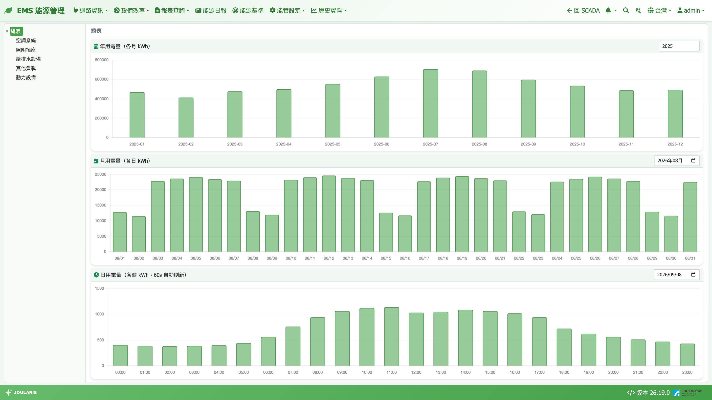

# 迴路資訊

迴路資訊頁讓您用「點樹、看圖」的方式快速瀏覽任一迴路的用量：左邊點迴路，右邊同時顯示年、月、日三張長條圖。不需要設定查詢條件，適合日常巡看。

## 如何進入

導覽列 **迴路資訊**，下拉有四個頁面，版面與操作完全相同，只差能源別：

| 選單 | 看什麼 | 單位 |
|------|--------|------|
| **空調水系統迴路** | 冰水主機產生的冷量 | RT·h（冷凍噸小時） |
| **電力迴路資訊** | 用電量 | kWh |
| **自來水迴路資訊** | 用水量 | m³ |
| **氣迴路資訊** | 天然氣用量 | m³ |

> ⚠️ 注意：「空調水系統」與「自來水」是兩套完全不同的東西 —— 前者是冰水主機的冷量（冷凍噸），後者是自來水表的用水量。名稱都有「水」字，請勿混淆。

## 畫面說明

- **左欄：迴路階層樹** —— 依各自的迴路設定頁建好的樹狀結構顯示。進入頁面時預設選第一個最上層迴路（通常就是全廠）
- **右欄上方**：目前選取的迴路名稱（尚未選取時顯示「請選擇左側迴路」）
- **右欄三張長條圖**（以電力為例）：

| 圖表 | 內容 | 右上角選擇器 |
|------|------|-------------|
| **年用電量（各月 kWh）** | 一年 12 個月，每月一根柱 | 輸入年份 |
| **月用電量（各日 kWh）** | 一個月的每一天 | 選月份 |
| **日用電量（各時 kWh，60s 自動刷新）** | 一天 24 小時 | 選日期 |

其他三頁的圖表標題分別是「年冷量 / 月冷量 / 日冷量」、「年用水量…」、「年用氣量…」，單位隨能源別變化。

## 操作步驟

### 查看某條迴路

1. 在左側樹點選迴路（可點上層的「虛擬迴路」看合計，也可點單一電表）
2. 右側三張圖同時換成該迴路的資料
3. 滑鼠移到長條上可看到該時段的數值

### 切換年、月、日

1. 在任一張圖右上角改年份 / 月份 / 日期
2. 只有該張圖會重新載入，其他兩張不受影響
3. 日圖若選的是今天，每 60 秒會自動刷新

## 讀數說明

- **上層迴路 = 底下所有電表的合計**。若某子迴路在設定時被設為「扣除」（負號），它會從上層合計中減掉，例如「總表 − 已分攤的子表」
- **月的定義依能源別不同**：
  - 電力、自來水、氣：依各自的 [月結週期](billing-period)（電費、水費、氣費期別各自獨立），所以月圖可能是「6/16～7/17」而非「6/1～6/30」
  - 空調水系統：一律用曆月（每月 1 號到月底），與 [冷凍噸報表](refrigeration-ton) 數字一致
- 數值顯示到小數一位

## 常見狀況

| 狀況 | 原因與處理 |
|------|-----------|
| 左側樹是空的、右邊三張圖空白 | 尚未建立該能源別的迴路。請到 [電表/迴路設定](electricity-meter-setting)、[空調水系統迴路設定](chilled-water-system)、[自來水表/迴路設定](water-meter-setting) 或 [氣表/迴路設定](gas-meter-setting) 建立 |
| 圖下方出現「部分時段冰水主機資料不完整（可能斷線）」（或水表 / 氣表版本） | 該期間有主機或表計資料缺漏，數字可能偏低。請到 [趨勢圖](../scada/history) 檢查該點位是否斷線 |
| 本月或今天的柱子比預期低 | 當期尚未結束，只統計到目前為止；另外用量資料每小時整點後幾分鐘才彙整，最近一小時可能還沒算進來 |
| 某個月的柱子是 0 | 可能那段時間電表斷線或尚未安裝。可到 [用電報表](energy-report) 查同一區間，滑鼠移到該格可看到是否為「資料不完整」 |
| 某迴路的值是負的 | 該迴路設為「扣除」，或子表大於總表，請確認 [電表/迴路設定](electricity-meter-setting) 的正負號設定 |
