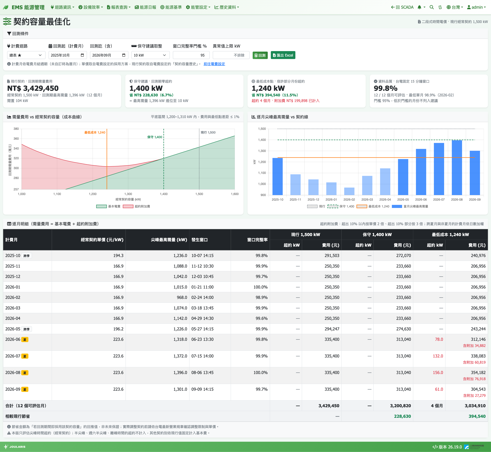

# 契約容量最佳化

這一頁用過去的實際需量「回測」：如果經常契約容量訂成某個數字，過去這段期間要付多少需量費用（基本電費 + 超約附加費）。系統會算出**保守建議**與**最低成本點**，協助您判斷契約容量是否訂得太高或太低。

## 如何進入

導覽列 **報表查詢 → 契約容量最佳化**

## 先了解：契約容量的取捨

台電的需量費用：

```
每月需量費用 = 經常契約容量 × 單價 + 超約附加費
```

- **契約訂太高**：每個月都多付基本電費（閒置容量）
- **契約訂太低**：超過契約的月份要付罰款：
  - 超出契約 10% 以內的部分：按單價 **2 倍** 計收
  - 超出 10% 以上的部分：按單價 **3 倍** 計收

台電以 **15 分鐘平均需量** 為準，每個整刻（00、15、30、45 分）結束一個窗口。本頁就是用這些固定窗口中「尖峰時間」的最高需量來回測。

## 開始前的準備

1. 計費電表已在 [電表/迴路設定](electricity-meter-setting) 勾選需量計算
2. 已在 [費率設定](tariff) 選擇採用的電價方案（單價來源）
3. 建議在電費設定的 **契約容量歷史** 填入現行契約，才能算出「現行」費用與節省金額

## 回測條件



| 欄位 | 說明 |
|------|------|
| **計費迴路** | 已啟用需量計算的電表；主要電表排最前面並標 ★ |
| **回測起（計費月）** / **回測訖（含）** | 預設為上個月往回 12 個月，最多 24 個計費月 |
| **保守建議取整** | 保守建議要進位到幾 kW（1 / 5 / 10 / 50 / 100，預設 10） |
| **窗口完整率門檻 %** | 當月有效 15 分鐘窗口占比低於此值時，該月不列入建議（預設 95） |
| **異常值上限 kW** | 超過此值的需量視為電表跳動並排除，例如填變壓器容量；留空 = 不排除 |

計費月依電費的 [月結週期](billing-period)（未自訂時為曆月）。

## 操作步驟

1. 選 **計費迴路**
2. 設定回測起訖（建議涵蓋至少一個完整年度，夏月與非夏月都有）
3. 視需要調整取整、完整率門檻、異常值上限
4. 按 **回測**
5. 檢視 KPI、圖表與逐月明細
6. 需要留存或給主管看時按 **匯出 Excel**

## 結果怎麼看

### 四張 KPI 卡

| 卡片 | 意思 |
|------|------|
| **現行契約 · 回測期需量費用** | 用您現行的契約容量算出回測期總需量費用，並顯示回測期最高需量與閒置 kW |
| **保守建議 · 回測期零超約** | 回測期間每個月都不會超約的最小契約（最高需量進位到取整單位）；附「省 NT$ …」 |
| **最低成本點 · 容許部分月份超約** | 總費用最低的契約容量，通常會讓少數月份超約；顯示超約幾個月與已計入的附加費 |
| **資料品質 · 台電固定 15 分鐘窗口** | 幾個月可評估、最低單月完整率 |

### 成本曲線

**需量費用 vs 經常契約容量（成本曲線）**：橫軸是契約容量，縱軸是回測期總費用（萬元），分成「基本電費」與「超約附加費」兩層。圖上會標出現行、保守、最低成本三條線，以及「平底區間」——在這個範圍內費用與最低點差不到 1%。

> 💡 提示：成本曲線底部通常很平。與其追求最低點，可以在平底區間內選一個比較保守的數字，兼顧省錢與超約風險。

### 逐月尖峰最高需量 vs 契約線

每月一根柱（夏月顏色較深、不可評估的月份為灰色），疊上現行（契約變更時會呈階梯）、保守、最低成本三條契約線，一眼看出哪幾個月會超約。

### 逐月明細

每個計費月列出 **經常契約單價 (元/kW)**、**尖峰最高需量 (kW)**、**發生窗口**、**窗口完整率**，以及三種方案的 **超約 kW** 與 **費用 (元)**。最下方是合計與 **相較現行節省**。

- 標「夏」為夏月，「跨季」表示該計費月跨越夏月與非夏月，費用依日數比例加權
- 完整率旁的「排除 N 筆」是被異常值上限濾掉的樣本數

## 判讀與注意事項

> ⚠️ 注意：節省金額是「若回測期間就採用該契約容量」的**回推值，不是未來保證**。實際調整契約前，請依台電最新營業規章確認調整限制、最低契約容量與單價。

- 本版**只評估尖峰時間的經常契約**；半尖峰、週六半尖峰、離峰的超約不計入，其他契約別依現行值固定計入基本費
- 需量是由電表度數換算而來，電表跳動可能造成假尖峰。請對照明細的 **發生窗口** 到 [趨勢圖](../scada/history) 確認；必要時填 **異常值上限** 排除
- 功率因數調整、營業稅不在需量費範圍內

## 常見狀況

| 狀況 | 原因與處理 |
|------|-----------|
| 計費迴路顯示「（無啟用需量的電表）」 | 到 [電表/迴路設定](electricity-meter-setting) 為計費電表勾選需量計算 |
| 現行費用顯示「未設定契約容量」 | 到 [費率設定](tariff) 的契約容量歷史填入現行契約；未填仍可看建議值，但算不出節省金額 |
| 某月標「窗口完整率不足」 | 該月電表斷線太多，不列入建議。可降低門檻，但數字可信度會下降 |
| 某月標「未採用電價方案」或「方案無經常契約」 | 該期沒有採用方案，或方案（如表燈累進）沒有經常契約，無法評估 |
| 出現「回測期間曾更換電價方案」 | 逐月會依當時方案的單價計算，屬正常提示 |
| 出現「回測期間最多 24 個計費月」 | 縮短回測區間 |
