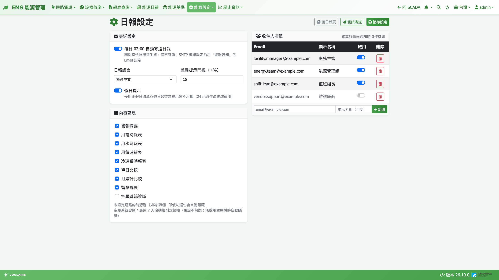

# 日報設定

[能源日報](daily-report)每天清晨自動整理**前一天**全廠的用電、用水、用氣、冷凍噸、警報與比較分析，並可寄送 Email。本頁設定日報要不要寄、寄給誰、用什麼語言、包含哪些區塊。

**進入方式**：**能管設定 → 設定 → 日報設定**；也可以在能源日報頁右上按 **日報設定** 進入。

## 畫面說明

- 右上按鈕：**回日報頁**、**測試寄送**、**儲存設定**
- **寄送設定**：自動寄送開關、**日報語言**、**差異提示門檻（±%）**、**假日提示**
- **內容區塊**：日報要包含的區塊勾選
- **收件人清單**：Email、**顯示名稱**、**啟用**、**刪除**

## 寄送設定

| 設定 | 說明 |
|------|------|
| **每日 02:00 自動寄送日報** | 勾選後每天 02:00 寄出前一天的日報。關閉時日報照常產生、可在網頁查看，只是不寄信 |
| **日報語言** | **繁體中文** / **English**，全體收件人共用一種語言；提示文字與警報訊息以此語言產生 |
| **差異提示門檻（±%）** | 用量與比較基準相差超過此百分比時，智慧摘要才會提出提示（預設 15，可設 1～100） |
| **假日提示** | 取消勾選後，假日徽章與假日相關的提示都不會出現，適合 24 小時連續生產、不分平假日的工廠 |

> 💡 提示：寄信使用的郵件伺服器，沿用警報通知的 Email 設定，不需另外設定。若寄不出去，請先確認警報設定的 Email 能正常寄信。

修改後按右上 **儲存設定**。

## 內容區塊

可勾選的區塊：**警報摘要**、**用電時報表**、**用水時報表**、**用氣時報表**、**冷凍噸時報表**、**單日比較**、**月累計比較**、**智慧摘要**、**空壓系統診斷**。

- **空壓系統診斷** 預設不勾選；它引用空壓機效率診斷最近 7 天的篩檢結果，沒有啟用的空壓機時自動隱藏
- 沒有設定迴路的能源別（例如沒有建氣表樹），即使勾選也會自動隱藏
- 區塊勾選**同時影響網頁與 Email**，且修改後對**過去的日報也立即生效**（日報內容都保留完整資料，只是顯示時過濾）

勾選完按 **儲存設定**。

## 收件人清單

### 新增收件人

1. 在清單下方輸入 Email 與 **顯示名稱**（可空）
2. 按 **新增**，立即生效

### 暫停或刪除

- 取消 **啟用** 勾選：暫時不寄給此人，保留在清單中
- 按 **刪除**：確認後移除

> 💡 提示：日報收件人清單**獨立於警報通知的收件群組**，兩邊需分別維護。收件人的新增、啟用切換、刪除都是按下就生效，不需要再按「儲存設定」。

## 測試寄送

按 **測試寄送**，系統立即以「昨天」的日報內容寄給清單中所有**已啟用**的收件人，主旨會加上【測試】。用來確認收件人地址與信件版面是否正確。

- 測試寄送不會影響正式日報的寄送狀態
- 短時間內不能連續按，需稍候約 10 秒再試

## 注意事項

- 日報固定在每天 02:00 產生前一天的內容；產生時的資料會保存下來，之後即使補了資料，該天的日報內容也不會改變
- 系統若在 02:00 時關機，當天重新啟動後仍會產生並寄出昨天的日報；更早幾天缺少的日報會補產生，但**不會補寄**
- 某天寄送失敗不會自動重寄，可用 **測試寄送** 手動補寄昨天的日報
- 智慧摘要為規則式判斷（例如用量變化、溫度差異、警報關聯），不使用外部 AI 服務
