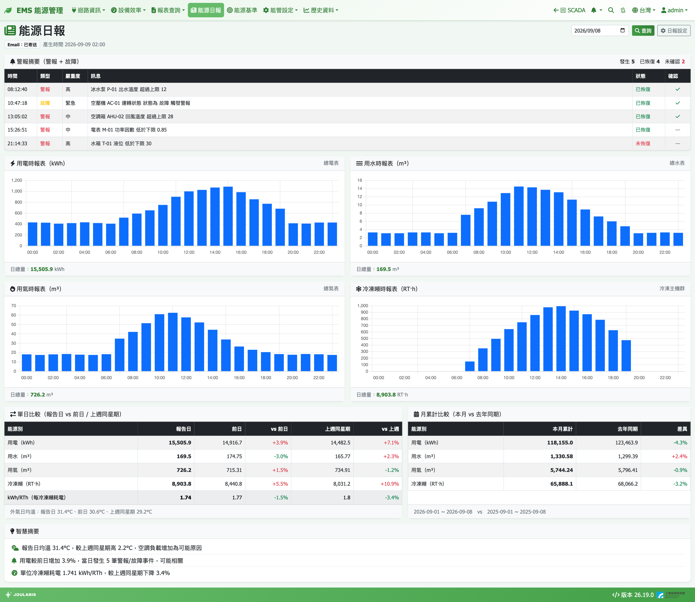

# 能源日報

能源日報每天凌晨自動整理**前一天**的全廠營運概況：警報摘要、電 / 水 / 氣 / 冷凍噸每小時用量、與前日及上週同日的比較、本月累計與去年同期比較，以及自動提示可能的差異原因。早上打開信箱或這一頁，就能快速掌握昨天的能耗與異常。

## 如何進入

導覽列 **能源日報**（位於「報表查詢」右側）

## 日報什麼時候產生

- 每天凌晨 **02:00** 自動產生前一日的日報，並存成一份「快照」
- 若有在 [日報設定](daily-report-setting) 開啟自動寄送，同時以 Email 寄給收件人
- Email 與本頁看到的是**同一份快照**，內容一致
- 之後即使有資料回補，已產生的歷史日報內容也不會改變

## 查看日報

1. 頁面右上角的日期欄預設為昨天
2. 選擇要看的日期（只能選昨天以前）
3. 按 **查詢**

有權限的使用者右上角還會看到 **日報設定** 按鈕，可直接前往設定頁。

### 狀態徽章

日期下方可能出現以下徽章：

| 徽章 | 意思 |
|------|------|
| **假日** | 報告日是國定假日或休假日 |
| **最後時段資料缺漏** | 報告日最後一小時（23 時）的資料不完整 |
| **即時計算** | 這一天沒有凌晨產生的快照，目前看到的是即時算出的結果 |
| **Email：已寄送 / 未寄送 / 寄送失敗 / 寄送停用** | 該日日報的 Email 寄送狀態；滑鼠移上去可看細節 |

## 日報內容

各區塊是否顯示，由 [日報設定](daily-report-setting) 決定；尚未建立迴路的能源別會自動隱藏。

### 警報摘要（警報 + 故障）

前一天發生的警報與故障事件統計，以及明細表（**時間** / **類型** / **嚴重度** / **訊息** / **狀態** / **確認**）。預設只顯示前 20 筆，點 **展開全部（共 N 筆）** 看全部。沒有事件時顯示「無警報/故障事件」。

### 四張時報表

**用電時報表（kWh）**、**用水時報表（m³）**、**用氣時報表（m³）**、**冷凍噸時報表（RT·h）**：24 小時長條圖，下方為 **日總量**。數字是各能源別**最上層迴路（全廠）**的合計。

### 單日比較（報告日 vs 前日 / 上週同星期）

| 欄位 | 意思 |
|------|------|
| **報告日** | 昨天的總量 |
| **前日** / **vs 前日** | 再前一天的總量與差異 % |
| **上週同星期** / **vs 上週** | 7 天前（同一個星期幾）的總量與差異 % |

表中另有 **kWh/RTh**（每冷凍噸耗電）一列，代表空調系統效率：數值越低越省電。有設定氣象資料時，下方會附外氣日均溫。

> 💡 提示：若報告日與上週同星期一天是上班日、一天是假日（例如遇到國定假日或補班），表格下方會提醒「比較基準不同」，此時 vs 上週的差異僅供參考。

### 月累計比較（本月 vs 去年同期）

**本月累計**（本月 1 日到報告日）對比 **去年同期**（去年同月 1 日到同一天），以及 **差異**。

### 智慧摘要

系統依固定規則自動產生的提示（不使用外部 AI 服務），差異超過 [日報設定](daily-report-setting) 中的門檻（預設 ±15%）時才會出現，例如：

| 類型 | 範例 |
|------|------|
| 天氣差異 | 「報告日均溫 33.2°C，較上週同星期高 4.1°C，空調負載增加為可能原因」 |
| 警報關聯 | 「用電較前日增加 18.2%，當日發生 3 筆警報/故障事件，可能相關」 |
| 效率異常 | 「單位冷凍噸耗電上升，主機效率或負載率變化為可能原因」 |
| 假日效應 | 提醒比較基準日的假日 / 上班日狀態不同 |
| 無明確線索 | 「差異原因無明確線索，建議查看時趨勢圖進一步分析」 |

### 空壓系統診斷（選用）

若在日報設定中勾選，會列出空壓系統最近 7 天診斷中觸發的項目、篩檢節能金額區間與建議下一步。點 **詳細診斷** 可前往 [冰機 / 空壓機效率診斷](equipment-efficiency) 的系統診斷頁。

## 數值顯示

- kWh 與 RT·h 顯示小數一位；用水、用氣最多兩位；kWh/RTh 三位
- 數字口徑與各報表頁相同，逐迴路明細請到 [用電報表](energy-report)、[用水與水費報表](water-report)、[用氣與氣費報表](gas-report)、[冷凍噸報表](refrigeration-ton) 查詢

## 常見狀況

| 狀況 | 原因與處理 |
|------|-----------|
| 選今天的日期選不到 | 日報只提供昨天以前的資料 |
| 某天顯示「即時計算」 | 那天凌晨系統可能沒有運作，系統啟動時會自動補產生最近幾天的快照（補產生的不會補寄 Email） |
| 沒有收到日報 Email | 到 [日報設定](daily-report-setting) 確認已開啟自動寄送、收件人已啟用；寄送失敗的日報可用設定頁的「測試寄送」手動補寄 |
| 某能源別區塊沒出現 | 該能源別尚未建立迴路，或在日報設定中未勾選 |
| 出現「最後時段資料缺漏」 | 23 時的資料尚未完整，可能是表計斷線，日總量可能偏低 |
