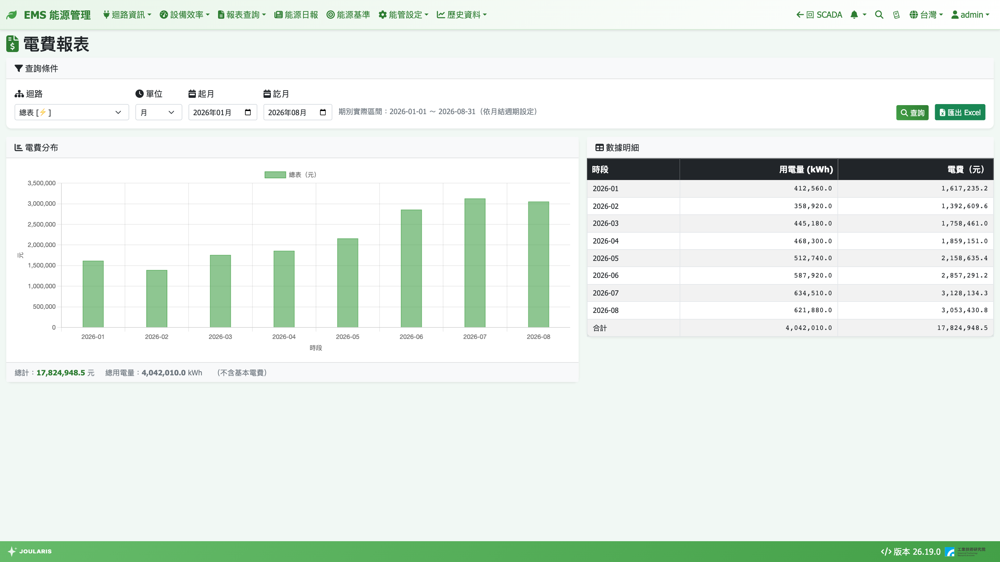

# 電費報表

電費報表用法與 [用電報表](energy-report) 相同，但查出來的是**流動電費（元）**。可用來估算各部門、各迴路的電費分攤，或觀察電費在一天、一個月內的分布。

## 如何進入

導覽列 **報表查詢 → 電費報表**

> 💡 提示：電費報表與用電報表的權限是分開的，管理員可以只開放看度數、不開放看金額。

## 開始前的準備

電費報表的金額依據 [費率設定](tariff) 中「採用的電價方案」計算。使用前請確認：

1. 已在電費設定選擇採用方案
2. 若剛換方案或想讓歷史資料用新方案重算，已在電費設定執行 **重新計算電費**

電費資料每小時整點後幾分鐘自動計算一次。

## 畫面說明

- **查詢條件**：**迴路**、**單位**（**時** / **日** / **月** / **年**）、起訖時間、**查詢**、**匯出 Excel**
- **電費分布**：每個時段的電費長條圖，滑鼠移上去同時顯示度數
- **數據明細**：**時段** / **用電量 (kWh)** / **電費（元）**，最後一列 **合計**；上方顯示 **總計** 與 **總用電量**

## 查詢步驟

1. 選 **迴路**
2. 選 **單位**，填起訖（起時 / 訖時、起日 / 訖日、起月 / 訖月、起年 / 訖年）
3. 按 **查詢**
4. 需要存檔時按 **匯出 Excel**

「月」單位依 [月結週期](billing-period) 的電費期別切分，選擇器旁會顯示期別實際區間，與台電帳單期間一致。

## 金額怎麼算

| 電價方案 | 計算方式 |
|----------|----------|
| 時間電價（尖峰 / 半尖峰 / 離峰） | 每小時的用電度數 × 該小時所屬時段的單價，逐時加總 |
| 單一費率 | 度數 × 當季單價 |
| 累進費率（級距） | 以**整期**的總度數套級距算出整期電費，再依各時段度數比例分攤 |

- 時段判定會參考 [國定假日與班別](holiday-shift) 中的假日設定（國定假日比照週日 / 離峰日的時段計價）
- 子迴路的累進電費是依它占全廠度數的比例分攤，屬**估算**，頁面會出現「⚠ 含級距分攤估算金額（累進方案按 kWh 占比分攤）」
- 選「月」查詢累進方案時金額最準確；時 / 日 / 年是分攤值

> ⚠️ 注意：本報表只含**流動電費**，**不含基本電費**，也不含簡易型時間電價的「月總度數超額加價」。EMS 首頁的電費狀態卡有含超額加價，所以觸發加價的月份兩邊合計會差這筆金額，屬正常。

## 匯出 Excel 內容

- 查詢條件區 + 表格：期間、kWh、電費
- 選上層迴路時，每個直接子迴路各多一欄電費
- 註記列會標明「不含基本電費」，有估算時也會註明

## 常見狀況

| 狀況 | 原因與處理 |
|------|-----------|
| 圖表顯示「該區間尚無電費資料」 | 尚未選擇採用方案，或該區間還沒計算。請到 [費率設定](tariff) 選方案，並對此區間執行「重新計算電費」 |
| 電費報表與實際帳單不同 | 本報表不含基本電費、功率因數調整、營業稅等；只比流動電費 |
| 換了電價方案，舊月份金額沒變 | 已算過的資料會保留當時方案的金額；要用新方案重算，請在電費設定執行重新計算 |
| 有些時段電費是負的 | 該迴路設為「扣除」（例如總表 − 子表），屬正常 |
| 看不到明細 / 合計切換或斷線 ⚠ 標記 | 電費報表沒有這兩項功能，請改用 [用電報表](energy-report) 查看 |
