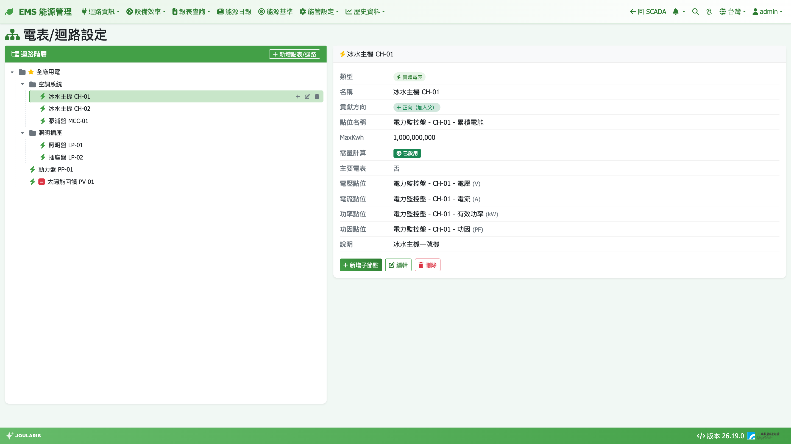
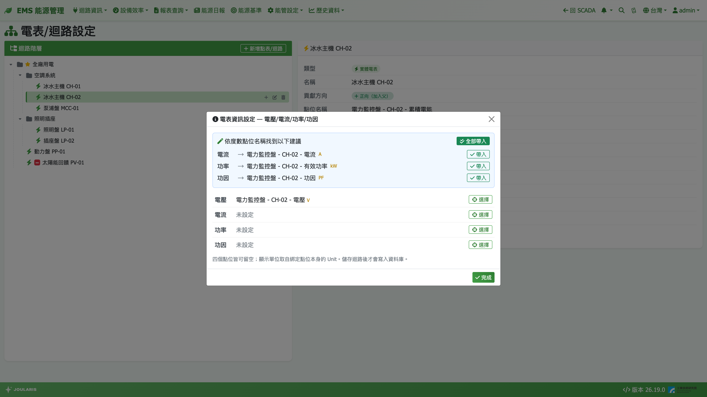
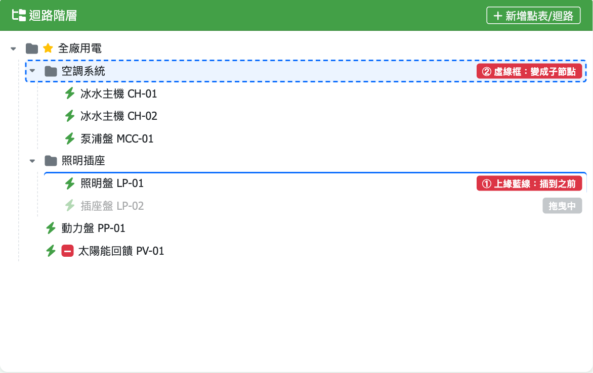

# 電表/迴路設定

本頁用來建立全廠的**電表 / 迴路階層樹**。用電報表、電費報表、EMS 首頁卡片、迴路資訊、能源申報、能源日報等所有「用電」數字，都是依這棵樹加總出來的，因此這是 EMS 用電功能的第一步設定。

**進入方式**：**能管設定 → 電表 → 電表/迴路設定**

## 基本觀念

樹上的每一個節點稱為「迴路」，分成兩種：

| 節點類型 | 說明 | 用電量怎麼來 |
|----------|------|--------------|
| **實體電表** | 綁定一個累積度數（kWh）點位 | 該點位讀數的增量 |
| **虛擬迴路** | 不綁點位，只用來分組 | 底下所有實體電表的用電量加總 |

- 虛擬迴路可以一層層往下分，例如「全廠 → 空調系統 → 冰機群 → 冰機 1」
- 每個節點都有**貢獻方向**：**正向（加入父）**或**反向（從父扣減）**，可組出「A + B + C − D」這類算式（見下方「設定貢獻方向」）
- 全系統可以指定一顆**主要電表**，EMS 首頁的主要電表卡片都以它為準

> 💡 提示：結構改動（新增、刪除、搬移、改貢獻方向）會**立即**反映到所有報表，包含過去月份 —— 系統每次查詢都依「當下的樹」重新加總，不需要也沒有回填動作。

## 畫面說明



- **左側「迴路階層」**：樹狀清單。滑鼠移到節點上會出現 ＋（**新增子節點**）、✎（**編輯**）、🗑（**刪除**）三個小按鈕
  - 金色 ★ = 主要電表
  - 紅色 **−** 標記 = 反向（從父扣減）的節點
- **右上「新增點表/迴路」**：建立最上層的節點
- **右側詳情區**：點選節點後顯示類型、點位、累積最大值 MaxKwh、需量計算、主要電表、貢獻方向、說明等資訊，下方也有 **新增子節點** / **編輯** / **刪除** 快速按鈕

## 新增迴路節點

1. 第一層：按右上 **新增點表/迴路**；子層：在父節點上按 ＋ 或在詳情區按 **新增子節點**
2. 輸入 **名稱**（例如「空調水系統」「冰機 1」）
3. 選 **節點類型**：**虛擬迴路** 或 **實體電表**
4. 若是子節點，選擇 **貢獻方向**（預設 **正向（加入父）**）
5. 選填 **說明**，按 **儲存**

### 綁定實體電表點位

節點類型選 **實體電表** 後，以三層下拉挑選點位：

1. **通訊設備**：依來源分組（Modbus 通訊設備 / 計算點位 / DB 來源），只會列出底下有 kWh 點位的設備
2. **子單元**：只有一台通訊設備下掛多個子設備時才會出現
3. **度數對應點位**：只列出單位為 **kWh** 的累積點位
4. **累積最大值 MaxKwh**：電表讀數到上限會歸零重算時，填入這個上限值（例如 1,000,000,000），系統才能正確算出跨越歸零那段的用電；留空表示不處理溢位

> ⚠️ 注意：電表讀數倒退（歸零或換表）又沒有設定 MaxKwh 時，該時段用電會被當成 0 並出現警告。若現場電表會溢位歸零，請務必填 MaxKwh。

### 啟用需量計算

實體電表下方有 **啟用需量計算** 勾選框。勾選後系統會以這顆電表的度數持續計算 15 分鐘需量，供 EMS 首頁「今日即時需量」卡片與[契約容量最佳化](contract-capacity)使用。只需在要監控需量的電表（通常是總表）勾選。

## 設定貢獻方向（加減算式）

**貢獻方向**決定這個節點對上一層是「加進去」還是「扣掉」，常見用途是「總表 − 已分配子表 = 其他用電」：

```
其他用電（虛擬迴路）
├── 總表         正向（加入父）
├── 冰機群       反向（從父扣減）
└── 照明         反向（從父扣減）
```

- 把整個群組設為反向，群組底下所有電表都會一起被扣減
- 最上層（根節點）沒有方向可選，固定為正向
- 反向的迴路在報表中可能出現**負值**，屬正常

> ⚠️ 注意：計算點位公式本身若已經做了減法（例如 A − B），就不要再用反向迴路扣一次，系統不會偵測重複扣減。兩種方式擇一即可。

## 設定主要電表

1. 編輯要當主要電表的節點，勾選 **主要電表**
2. 按 **儲存** —— 全系統只能有一顆，勾選新的時原本的主要電表會自動取消

實體電表與虛擬迴路都可以當主要電表：

- **實體電表**：EMS 首頁「主要電表資訊」卡片顯示它自己綁定的電壓 / 電流 / 功率 / 功因
- **虛擬迴路**：電壓 / 電流 / 功率 / 功因由底下各實體電表**自動聚合**（電流、功率依貢獻方向加減；功因依功率重新推算，不是直接平均）

> 💡 提示：沒有設定主要電表時，EMS 首頁的主要電表長條圖、圓餅圖、去年同期比較卡片會提示「尚未設定主要電表」。

## 電表資訊設定（電壓 / 電流 / 功率 / 功因）

每顆實體電表都可以另外綁定電壓、電流、功率、功因四個即時點位，用於主要電表資訊卡片與虛擬主表的聚合：

1. 在新增 / 編輯視窗選 **實體電表** 並選好度數點位後，按 **電表資訊設定**
2. 若系統依度數點位名稱找到同一台設備上的候選點位，頂部會出現建議卡，可按 **全部帶入** 或逐列 **帶入**
3. 要手動指定時，按該列的 **選擇**：左邊挑 **通訊設備**、右邊挑 **點位**（可用關鍵字搜尋名稱或 SID），按 **確定**；按 **清除綁定** 可清空該列
4. 按 **完成** 回到編輯視窗，最後**一定要按「儲存」**才會真正寫入

四個點位都可以留空；虛擬迴路沒有這個按鈕。



## 拖曳搬移節點

所有能管設定的迴路樹（電表、空調水系統、自來水表、氣表、產氣量表）都支援用滑鼠拖曳來**調整順序**或**搬到另一個父節點底下**。本節說明一次，其他章節不再重複。

拖曳一個節點到目標節點上，依放開時滑鼠在目標列的位置決定結果：

| 放開位置 | 結果 |
|----------|------|
| 目標列的上緣（上 1/4） | 插到目標**之前**（出現上緣藍線） |
| 目標列的下緣（下 1/4） | 插到目標**之後**（出現下緣藍線） |
| 目標列的中間 | **變成目標的子節點**（出現虛線框） |
| 樹的空白處 | 搬到**最上層**末端 |

- 不允許的位置拖曳時**不會出現任何標記**，放開也不會有動作（例如拖到自己的子節點底下）
- **同一層換順序**：直接生效，不會詢問
- **跨層搬動**：會先跳出確認，提醒「搬動後上層迴路的加總與報表會立即改變」
- **放到實體電表底下**：確認訊息會多一行警告 —— 實體電表掛了子迴路後，會連自己的度數一起加總
- 電表頁搬到最上層時，該節點的貢獻方向會自動重設為正向
- 主要電表的 ★ 會跟著節點走，搬動不影響



> ⚠️ 注意：拖曳需使用滑鼠操作，平板等觸控裝置無法拖曳，請改用電腦。

## 刪除節點

1. 在節點上按 🗑 或詳情區的 **刪除**
2. 確認「確定要刪除…嗎？」
3. 若底下還有子節點，會再提醒「刪除會一併移除所有子孫」，確認後整支子樹一起刪除

刪除後，所有報表會立即不再計入這些迴路。

## 注意事項

- **改結構 = 改歷史**：報表永遠依目前的樹計算，搬移或刪除後，過去月份的數字也會跟著變。若需保留某時點的報表，請先**匯出 Excel**
- **避免在實體電表底下掛子迴路**：實體電表會連自身一起加總，容易重複計算；分組請用虛擬迴路
- **度數點位只列 kWh**：點位單位不是 kWh（例如標成「度」或 Wh）時下拉找不到，請先請工程師修正點位單位
- 電費相關數字還需完成[月結週期](billing-period)與[電費設定](tariff)

## 常見錯誤

| 狀況 | 原因與處理 |
|------|-----------|
| 儲存時出現「實體電表必須選擇 SID」 | 節點類型選了實體電表但沒選度數點位 |
| 某月用電突然變成 0 並有 ⚠ 警告 | 電表斷線或讀數倒退；若是溢位歸零，請補填 MaxKwh |
| 報表總量比預期多 | 檢查是否在實體電表底下掛了子迴路，或同一顆電表被放在兩個位置 |
| 「其他用電」出現負值 | 扣減的子表加總大於總表，檢查子表是否重複或貢獻方向設錯 |
