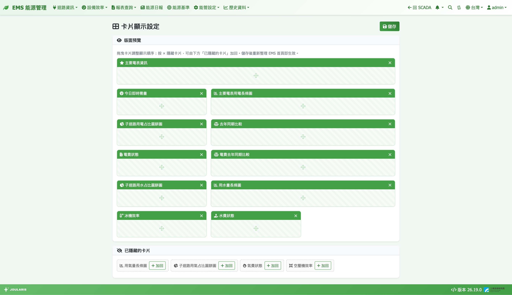

# 卡片顯示設定

本頁用來決定 [EMS 首頁](ems-home)要顯示哪些卡片、以什麼順序排列。不需要的卡片可以隱藏，常用的卡片可以拉到最前面。

**進入方式**：**能管設定 → 設定 → 卡片顯示設定**

> 💡 提示：本設定是**全系統共用**的，修改後所有使用者看到的 EMS 首頁都會改變。

## 畫面說明

- **版面預覽**：每張卡片以縮圖呈現，寬度與 EMS 首頁實際比例相同（寬卡佔較多欄、窄卡佔較少欄），右上角有 **×**（**隱藏此卡片**）
- **已隱藏的卡片**：被隱藏的卡片列在這裡，每張有 **加回** 按鈕；全部都顯示時顯示「無 — 所有卡片皆顯示中」
- 右上 **儲存**

## 可設定的卡片

| 類別 | 卡片 |
|------|------|
| 電力 | 主要電表資訊、今日即時需量、主要電表用電長條圖、子迴路用電占比圓餅圖、去年同期比較 |
| 電費 | 電費狀態、電費去年同期比較 |
| 用水 | 用水量長條圖、子迴路用水占比圓餅圖、水費狀態 |
| 用氣 | 用氣量長條圖、子迴路用氣占比圓餅圖、氣費狀態 |
| 設備效率 | 冰機效率、空壓機效率 |

各卡片內容說明見 [EMS 首頁](ems-home)。

## 調整卡片

### 調整順序

1. 在 **版面預覽** 中用滑鼠按住卡片拖曳到想要的位置
2. 預覽中的順序就是 EMS 首頁由左到右、由上到下的顯示順序

### 隱藏卡片

按卡片右上角 **×**，卡片移到下方 **已隱藏的卡片** 區。

### 加回卡片

在 **已隱藏的卡片** 區按 **加回**，卡片會回到預覽區的最後面，再拖曳到想要的位置。

### 儲存

按 **儲存**，看到「已儲存，重新整理 EMS 首頁即生效」後，回到 EMS 首頁**重新整理**即可看到新版面。

## 注意事項

- 隱藏的卡片在 EMS 首頁上完全不會載入，也不會在背景更新資料，可讓首頁更輕快
- 全部卡片都隱藏時，EMS 首頁會顯示「尚未啟用任何卡片」
- 卡片顯示與否和資料設定無關：例如沒有設定主要電表時，主要電表相關卡片仍會顯示，但內容會提示「尚未設定主要電表」；建議把用不到的能源別（例如廠內沒有天然氣）的卡片隱藏
- 系統日後新增的卡片會自動出現在預覽最後面（預設顯示）
- 拖曳需使用滑鼠，觸控裝置可能無法操作
