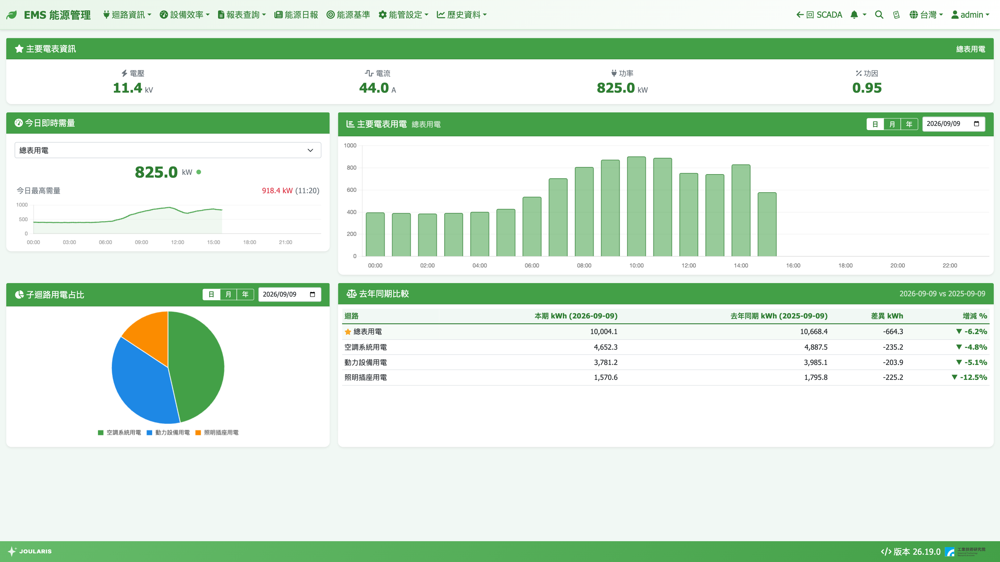

# EMS 首頁

EMS 首頁是能源管理模組的「總覽儀表板」：一打開就能看到全廠用電、需量、電費、用水、用氣與主要設備效率的即時狀況，再從上方選單鑽進各報表細查。

## 如何進入

- 從 SCADA 畫面：點導覽列右側的 **← 回 EMS**
- 在 EMS 任一頁：點左上角的品牌字 **EMS 能源管理**（葉子圖示）即回到首頁

進入 EMS 後，導覽列會換成淡綠色主題，選單只剩能源管理相關的項目：

| 選單 | 內容 |
|------|------|
| **迴路資訊** | 空調水系統迴路、電力迴路資訊、自來水迴路資訊、氣迴路資訊 |
| **設備效率** | 冰機效率診斷、空壓機效率診斷、設備效率設定 |
| **報表查詢** | 用電報表、電費報表、契約容量最佳化、冷凍噸報表、用水報表、水費報表、用氣報表、氣費報表、能源申報、空壓機能源申報 |
| **能源日報** | 每日自動產生的前一日營運概況 |
| **能源基準** | ISO 50001 能源基線、EnPI、SEU 鑑別 |
| **能管設定** | 電表 / 水表 / 氣表 / 產氣量表的迴路、月結週期、費率，以及假日、班別、卡片顯示等設定 |
| **歷史資料** | 趨勢圖、事件記錄 |

要回到 SCADA 監控畫面，點導覽列右側的 **← 回 SCADA**。

> 💡 提示：選單項目會依您的帳號權限顯示，看不到某個選單代表管理員沒有開放該頁給您。

## 畫面上的卡片

首頁由多張卡片組成，管理員可在 [卡片顯示設定](ems-card-setting) 決定要顯示哪些、排列順序為何。可用的卡片如下：

### 用電相關

| 卡片 | 看什麼 |
|------|--------|
| **主要電表資訊** | 主要電表目前的 **電壓**、**電流**、**功率**、**功因** |
| **今日即時需量** | 選一個迴路，看目前需量 kW、**今日最高需量** 與全天需量趨勢線，每 60 秒自動更新 |
| **主要電表用電長條圖** | 主要電表的用電量，可切 **日**（各小時）/ **月**（各日）/ **年**（各月） |
| **子迴路用電占比圓餅圖** | 主要電表底下各子迴路占總用電的比例 |
| **去年同期比較** | 主要電表與各子迴路：**本期 kWh**、**去年同期 kWh**、**差異 kWh**、**增減 %** |
| **電費狀態** | 本期（電費月結期別）累計用電度數與流動電費，依您採用的電價方案顯示各時段或級距明細 |
| **電費去年同期比較** | 同「去年同期比較」，但比的是 **本期電費 (元)** 與 **去年同期 (元)** |

### 用水、用氣

| 卡片 | 看什麼 |
|------|--------|
| **用水量長條圖** / **用氣量長條圖** | 全廠（迴路樹最上層）的用水 / 用氣量，日 / 月 / 年切換 |
| **子迴路用水占比圓餅圖** / **子迴路用氣占比圓餅圖** | 各子迴路占比 |
| **水費狀態** / **氣費狀態** | 本期累計用量（m³）與各級距的流動水費 / 氣費 |

### 設備效率

| 卡片 | 看什麼 |
|------|--------|
| **冰機效率** | 每台冰機一列：運轉燈、名稱、即時 kW/RT 與評級（優 / 可 / 差），底部是本月累計平均效率與運轉時數 |
| **空壓機效率** | 每台空壓機一列：即時比功率 kW/(m³/min) 與評級，底部是本月累計 |

點卡片標題可直接開啟對應的診斷頁，詳見 [冰機 / 空壓機效率診斷](equipment-efficiency)。

## 常用操作

### 切換長條圖的日 / 月 / 年

1. 在卡片右上角點 **日**、**月** 或 **年**
2. 旁邊的日期欄會跟著變成「選日期」「選月份」或「輸入年份」
3. 改日期後圖表立即更新

- **日**：一天 24 小時，每小時一根柱；選的是今天時每 60 秒自動刷新
- **月**：該月每日一根柱。這裡的「月」是依 [月結週期](billing-period) 設定的期別，不一定是 1 號到月底
- **年**：該年 12 期，每期一根柱

> 💡 提示：圓餅圖與「去年同期比較」共用同一組日 / 月 / 年切換；「電費去年同期比較」卡有自己的一組切換，預設為「月」。

### 看今日需量

1. 在 **今日即時需量** 卡的下拉選單選迴路（預設優先選主要電表）
2. 大字為目前需量（過去 15 分鐘平均功率），下方顯示 **今日最高需量**
3. 趨勢線可看出今天何時是用電高峰

> ⚠️ 注意：首頁的需量是每分鐘滾動計算的「監控值」，用於提早預警；台電計費採固定 15 分鐘窗口，兩者時間點不一定對齊。要評估契約容量請用 [契約容量最佳化](contract-capacity)。

### 讀電費狀態卡

- 卡片上方顯示「本期」的起訖日與 **本期累計 N kWh**
- 時間電價方案：列出尖峰 / 半尖峰 / 離峰各時段度數與電費
- 累進方案：顯示 **目前級距**；單一費率：顯示 **當季單價**
- 可用下拉切換子迴路。子迴路的級距類金額是依度數比例分攤，會標 **估算**
- 底部固定註記 **不含基本電費**，並顯示「資料計算至 …」—— 電費每小時整點後幾分鐘更新一次

## 讀數說明

- **增減 %** = 差異 ÷ 去年同期 × 100。▲ 紅色代表比去年多，▼ 綠色代表比去年少；去年沒資料時顯示 `--`
- 去年同期的「月」會用**去年同一期**的月結期別計算，不是單純把日期減一年
- 圓餅圖中若某子迴路期間總量為負值（例如設成「扣除」的迴路或發電回送），不會畫進圓餅，而是在卡片下方以小字列出「（未列入占比）」

## 常見狀況

| 狀況 | 原因與處理 |
|------|-----------|
| 卡片顯示「尚未設定主要電表」 | 到 [電表/迴路設定](electricity-meter-setting) 勾選一顆主要電表 |
| 電費狀態顯示「尚未選擇電費方案」 | 到 [費率設定](tariff) 選擇採用方案；點卡片上的 **前往電費設定** 可直接過去 |
| 水 / 氣卡顯示「尚未建立…迴路」 | 先到自來水表或氣表的迴路設定頁建立迴路 |
| 冰機 / 空壓機卡顯示「尚未設定」 | 到 [設備效率設定](equipment-efficiency-setting) 建立設備 |
| 首頁一張卡都沒有 | 所有卡片都被隱藏了，請到 [卡片顯示設定](ems-card-setting) 開啟 |
| 用水 / 用氣卡出現「部分時段水表資料不完整（可能斷線）」 | 該期間有表計斷線，數字可能偏低，請檢查通訊 |
