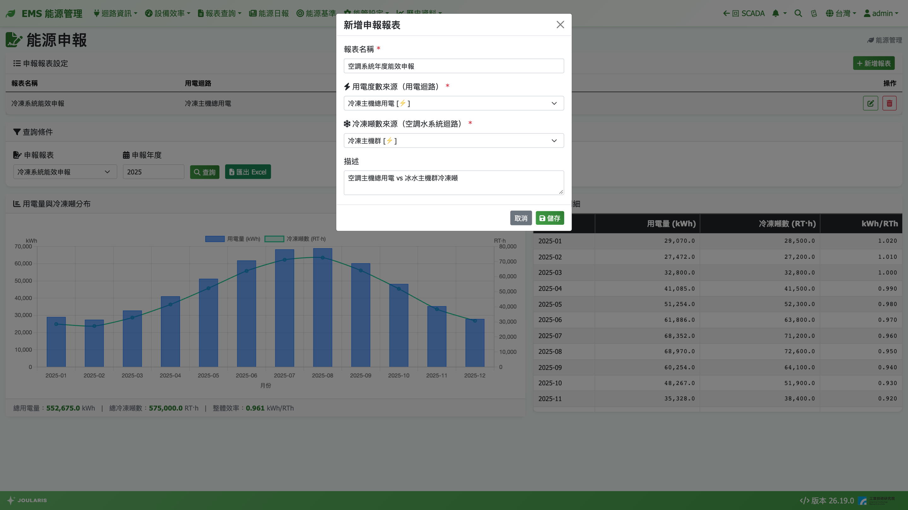
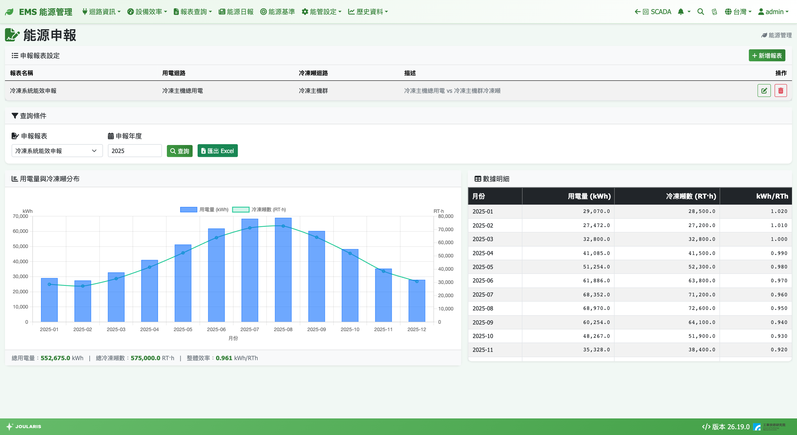

# 能源申報

能源申報頁專為年度能源申報設計：把一條用電迴路與一條空調水系統迴路配成一組，一鍵產出整年 12 個月的**用電量、冷凍噸數與每冷凍噸耗電（kWh/RTh）**，並可匯出 Excel 作為申報附件。

## 如何進入

導覽列 **報表查詢 → 能源申報**

## 與一般報表的不同

- **先設定、後查詢**：先建立「申報報表設定」，之後每年只要選報表與年度
- **格式固定**：只能選年度，固定輸出 1～12 月
- **固定曆月**：每月 1 號到月底，不受電費月結週期影響

## 建立申報報表

1. 在 **申報報表設定** 卡片按 **新增報表**
2. 在「新增申報報表」視窗填寫：
   - **報表名稱**：例如「A 棟申報」
   - **用電度數來源（用電迴路）**：例如 A 棟冰水系統的用電迴路
   - **冷凍噸數來源（空調水系統迴路）**：對應的冰水主機迴路
   - **描述**：選填
3. 按 **儲存**

用電迴路與空調水系統迴路兩者都必填。可建立多份，例如每棟建築各一份。清單的 **操作** 欄可 **編輯** 或 **刪除**。

## 查詢申報資料

1. 在 **查詢條件** 選 **申報報表**
2. 輸入 **申報年度**（預設今年）
3. 按 **查詢**
4. 需要存檔時按 **匯出 Excel**

### 結果怎麼看

- **用電量與冷凍噸分布**：用電量 (kWh) 為長條（左軸）、冷凍噸數 (RT·h) 為折線（右軸）；滑鼠移到某月會顯示「效率：… kWh/RTh」
- **數據明細**：**月份** / **用電量 (kWh)** / **冷凍噸數 (RT·h)** / **kWh/RTh**，最後一列 **合計**
- 下方顯示 **總用電量**、**總冷凍噸數**、**整體效率**

### kWh/RTh 怎麼解讀

**kWh/RTh** = 用電量 ÷ 冷凍噸數，代表「每產生 1 冷凍噸小時的冷量要花多少度電」，**數值越低越省電**。它也大約等於整段期間的平均 kW/RT。

- **整體效率** = 全年總用電 ÷ 全年總冷凍噸數（不是 12 個月效率的平均）
- 冷凍噸數為 0 的月份（例如冬天主機全停）效率顯示 `--`
- 用電迴路若包含水泵、冷卻水塔，算出的是「冰水系統」效率，會比單看主機的 kW/RT 高

## 匯出的 Excel

包含報表名稱、兩個迴路來源、申報年度、操作者，以及 12 個月的四欄資料與合計列，可直接作為申報佐證。

## AI 智慧幫手：任意區間效率

有能源申報權限的使用者，每一頁右下角都有 **AI智慧幫手** 對話窗，可快速分析任一申報報表在**任意日期區間**的效率：

1. 點右下角氣泡開啟，選 **區間效率分析**
2. 選擇申報項目
3. 設定 **起始日** 與 **結束日**，按 **開始分析**
4. 助理會回覆總用電量、總冷凍噸數、平均效率與評語

評語依平均效率分級：≤ 0.85 為「優異」、0.85～1.10 為「正常範圍」、> 1.10 為「效率偏高，建議檢查」。

## 數字的一致性

- 冷凍噸數與 [冷凍噸報表](refrigeration-ton) 的月數字一致（兩者都是曆月）
- 用電量可能與 [用電報表](energy-report) 的月數字不同，因為用電報表的「月」是電費期別，申報是曆月，屬正常

## 表格中的標記與警告

| 標記 / 訊息 | 意思 |
|------|------|
| ⚠（琥珀色） | 此區間電表資料不完整（可能斷線） |
| ◐（藍色） | 此月邊界缺讀數，僅統計月內有讀數的區段（電表月中上線或月底斷線） |
| 「⚠ 部分電表偵測到累積值倒退但未設 MaxKwh」 | 有電表讀數倒退但未設定溢位上限，請到 [電表/迴路設定](electricity-meter-setting) 補上 |
| 「⚠ 冷凍噸資料覆蓋率不足（每小時聚合尚未完成或缺資料）」 | 冰水主機資料有缺漏，冷凍噸數可能偏低 |

## 常見狀況

| 狀況 | 原因與處理 |
|------|-----------|
| 清單中迴路名稱顯示紅字「迴路已不存在」 | 綁定的迴路已被刪除，請按 **編輯** 重新選擇 |
| 當月冷凍噸數偏低 | 當月尚未結束，且冷量每小時整點後幾分鐘才彙整 |
| 申報下拉顯示「尚無申報報表」 | 先在申報報表設定按 **新增報表** |
| 空調水系統迴路下拉沒有選項 | 先到 [空調水系統迴路設定](chilled-water-system) 建立迴路 |
