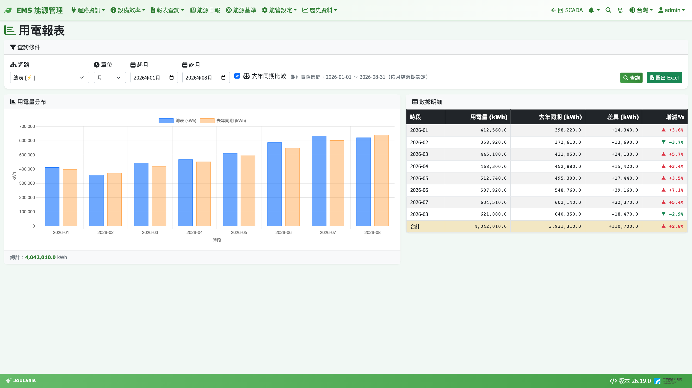

# 用電報表

用電報表讓您自訂迴路與時間區間，查詢用電量（kWh）並匯出 Excel。適合月底對帳、比較各部門用電、或回頭查某一天的用電分布。

## 如何進入

導覽列 **報表查詢 → 用電報表**

## 畫面說明

頁面由上而下分三區：

1. **查詢條件**：**迴路**、**單位**、起訖時間、**查詢** 與 **匯出 Excel** 按鈕
2. **用電量分布**：長條圖，下方顯示 **總計**
3. **數據明細**：每個時段一列（**時段** / **用電量 (kWh)**），最後一列為 **合計**

## 查詢用電量

1. **迴路**：從下拉選單選一個迴路（樹狀縮排顯示，可選上層合計或單一電表）
2. **單位**：選 **時**、**日**、**月**、**年** 或 **班別**，下方的起訖欄位會跟著切換

   | 單位 | 起訖欄位 | 每一列代表 |
   |------|----------|-----------|
   | **時** | **起時** / **訖時**（日期 + 小時） | 1 小時 |
   | **日** | **起日** / **訖日** | 1 天 |
   | **月** | **起月** / **訖月** | 1 個月結期別 |
   | **年** | **起年** / **訖年** | 1 個自然年 |
   | **班別** | **起日** / **訖日** | 某一天的某一班 |

3. 選好起訖時間（訖不可早於起，否則會提示「訖日不可早於起日」等訊息）
4. 按 **查詢**，圖表與表格隨即更新

> 💡 提示：單位選「日」時，起訖日預設為今天所屬的電費期別起訖，可直接查本期每日用電。

## 「月」是電費期別，不一定是 1 號到月底

用電報表的「月」依 [月結週期](billing-period) 中的**電費期別**切分，以便和台電帳單對得上。選月單位時，選擇器旁會顯示「期別實際區間：2026-06-16 ～ 2026-07-17（依月結週期設定）」這樣的提示。若沒有設定過月結週期，就是一般的自然月。

「年」單位則固定為 1/1～12/31。

## 去年同期比較

單位選「月」時，條件列會多一個 **去年同期比較** 勾選框（預設勾選）。

1. 勾選後按 **查詢**
2. 表格多出 **去年同期 (kWh)**、**差異 (kWh)**、**增減%** 三欄
3. 長條圖疊上一組淡橘色「去年同期」柱子方便對照

讀法：

- **增減%** = 差異 ÷ 去年同期 × 100；▲ 紅色為增加、▼ 綠色為減少
- 去年同期用的是**去年同一期**的期別區間
- 去年沒有資料時，該列顯示 `--`；合計列只加總有去年資料的期別

> ⚠️ 注意：若本期還沒過完，本期只統計到今天為止，而去年是完整一期，增減% 會偏低，判讀時請留意。

## 依班別檢視

單位選 **班別** 時，報表會依 [國定假日與班別](holiday-shift) 中定義的班別，把每天拆成各班一列：

- 單日查詢時列名就是班別名稱；跨多日時會加上日期
- 跨午夜的夜班（例如 22:00～06:00）整段算在**開始那一天**
- 沒有被任何班別涵蓋的時段會合併成一列「非班別」，因此各班加上非班別 = 當天總用電
- 若尚未設定任何班別，查詢時會提示您先設定

## 顯示明細 / 顯示合計

當您選的是**底下有兩個以上子迴路的上層迴路**時，圖表右上角會出現 **顯示明細** 按鈕：

- 預設是合計：單色長條
- 按 **顯示明細**：改成堆疊長條，每個子迴路一種顏色，滑鼠移上去會列出各子迴路的度數與合計
- 按 **顯示合計** 切回

每次重新查詢都會回到合計模式。

## 匯出 Excel

1. 先查詢出結果
2. 按 **匯出 Excel**，瀏覽器會下載 .xlsx 檔
3. 檔案內容包含查詢條件、各時段數據與合計
   - 選上層迴路時，每個**直接子迴路**會多一欄，方便看各分項占比
   - 選單一電表時，只有「時段 | 用電量」兩欄
   - 有勾去年同期比較時，Excel 也會多出去年同期 / 差異 / 增減% 三欄

## 數字怎麼算

- 每段用電 = 該段結束時的電表累積讀數 − 開始時的讀數
- 上層迴路 = 底下所有電表加總；設為「扣除」的子迴路會被減掉，所以合計可能出現負值（例如「總表 − 已分攤子表」）
- 查詢「今天」「本月」等尚未結束的時段時，只統計到目前為止
- 數值顯示到小數一位

## 表格中的標記

| 標記 | 意思 |
|------|------|
| ⚠（琥珀色） | 此區間電表資料不完整（可能斷線），數字顯示為 0 不代表真的沒用電 |
| ◐（藍色） | 此區間開頭或結尾缺讀數（例如電表月中才上線、或月底斷線），只統計有讀數的那段 |

滑鼠移到該格或長條上會顯示說明。

## 常見狀況

| 狀況 | 原因與處理 |
|------|-----------|
| 迴路下拉顯示「尚未設定迴路」 | 先到 [電表/迴路設定](electricity-meter-setting) 建立迴路 |
| 上方出現「⚠ 部分電表偵測到累積值倒退但未設 MaxKwh」 | 有電表讀數倒退（換表、歸零或溢位），但沒設定溢位上限，該段被當成 0。請到 [電表/迴路設定](electricity-meter-setting) 為該電表填入累積值上限 |
| 某個月整格是 0 並帶 ⚠ | 那段期間電表沒有資料，請到 [趨勢圖](../scada/history) 確認點位通訊 |
| 用電報表與能源申報的月份數字不同 | 用電報表的「月」走電費期別，能源申報固定曆月，兩者區間不同屬正常 |
| 修改了月結週期後歷史月報數字變了 | 報表是即時計算，期別改了會用新區間重算，屬正常 |
