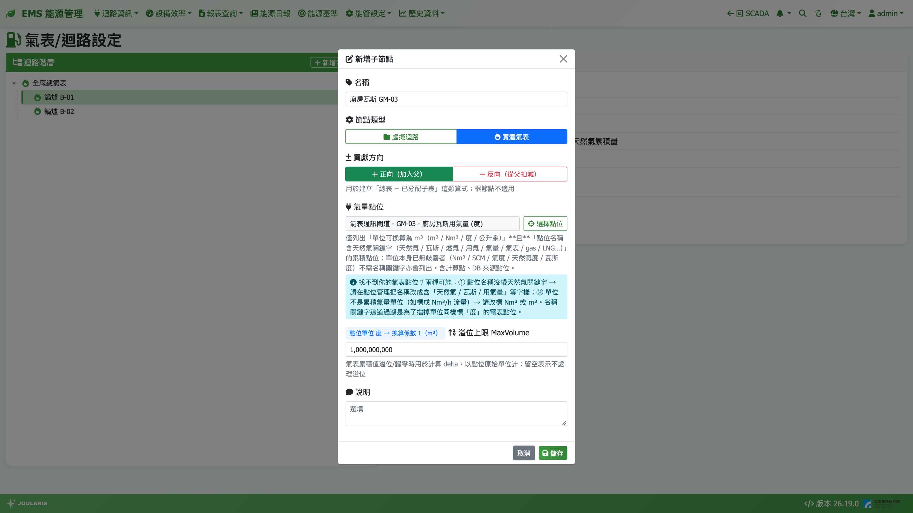

# 天然氣表/迴路設定

本頁用來建立**天然氣用氣的表計 / 迴路階層**。用氣報表、氣費報表、EMS 首頁的用氣量與氣費卡片、氣迴路資訊、能源日報的用氣時報表，都依這棵樹加總。

**進入方式**：**能管設定 → 天然氣表 → 天然氣表/迴路設定**

> ⚠️ 注意：本頁只放**天然氣（瓦斯）**表。空壓機的壓縮空氣產氣量請到[產氣量表/迴路設定](air-meter-setting)，放錯會被當成天然氣計算氣費。

## 基本觀念

本頁的版面與操作和[自來水表/迴路設定](water-meter-setting)幾乎相同：

| 項目 | 天然氣表 |
|------|------|
| 節點類型 | **虛擬迴路** / **實體天然氣表** |
| 可綁的點位 | 累積氣量點位（單位 m³、Nm³、度、公升系等），且名稱要能看出是天然氣 |
| 單位換算 | 一律換算成 m³（天然氣 1 度 = 1 m³），**報表以 m³ 顯示** |
| 溢位處理 | **溢位上限 MaxVolume**（以點位原始單位填寫） |
| 貢獻方向 | 有，**正向（加入父）** / **反向（從父扣減）** |
| 最上層節點 | **只能有一個**（代表全廠） |

系統不做熱值換算，全部以 m³ 計量。

## 畫面說明

- **左側「迴路階層」** 與 **右上「新增天然氣表/迴路」**：同水表頁
- **右側詳情區**：類型、名稱、貢獻方向、點位名稱、單位換算、溢位上限 MaxVolume、說明

## 新增天然氣表節點

1. 第一次使用時，按 **新增天然氣表/迴路** 建立全廠根節點，例如「全廠總天然氣表」
2. 在根節點上按 **新增子節點**，輸入 **名稱**（例如「鍋爐天然氣」）
3. 選 **節點類型** 與 **貢獻方向**
4. 選 **實體天然氣表** 時，按 **選擇點位** → 選 **通訊設備** → 選 **點位** → **確定**，確認顯示的單位換算係數正確
5. 視需要填 **溢位上限 MaxVolume**，按 **儲存**

## 為什麼找不到我的天然氣表點位？

天然氣表點位清單同時檢查**單位**與**點位名稱**兩個條件，兩者都符合才會列出：

1. **單位可換算成 m³**：m³、Nm³、SCM、度、氣度、公升等累積量單位
2. **點位名稱含天然氣關鍵字**：例如「天然氣」「瓦斯」「燃氣」「用氣」「氣量」「氣表」「gas」「LNG」等
   - 單位是 Nm³、SCM、氣度、天然氣度、瓦斯度這類不會跟其他能源混淆的單位時，名稱不必含關鍵字

之所以要看名稱，是因為「度」同時也是電表的單位，只看單位會把電表點位也撈進來，綁錯就會拿用電度數算氣費。

找不到時請依原因處理：

| 原因 | 處理 |
|------|------|
| 點位名稱沒有天然氣字樣 | 請工程師把點位名稱改成含「天然氣」「瓦斯」「用氣量」等字樣 |
| 單位是流量（例如 Nm³/h） | 改綁累積量點位，或把單位改標 Nm³ / m³ |

> 💡 提示：新增 / 編輯視窗中「氣量點位」旁有 **?** 圖示，滑鼠移上去即可看到同樣的篩選說明；點位清單只顯示點位名稱與單位，不顯示 SID。

## 拖曳搬移與刪除

- 操作方式與[電表/迴路設定 § 拖曳搬移節點](electricity-meter-setting)相同
- 與水表一樣：**全廠根節點不能拖動**，也不能拖成第二個根
- 刪除含子節點的迴路會一併刪除所有子孫

## 注意事項

- **改結構會立即影響歷史報表**：用氣報表、氣費報表依目前的樹計算
- 用氣量每小時彙整一次，最近一小時的數字稍後才會出現
- 綁定時的單位換算係數在綁定當下決定；點位單位事後變更時，請重新編輯並重選點位
- 已彙整的歷史資料不會因事後修改溢位上限而自動重算
- 氣費還需要設定[氣費月結週期](billing-period)與[氣費設定](tariff)

## 常見錯誤

| 狀況 | 原因與處理 |
|------|-----------|
| 儲存時出現「不符合氣量點位條件」 | 點位單位或名稱不符上述兩個條件，請修正點位後再選 |
| 把空壓機產氣量掛進天然氣表樹 | 會被計入氣費，請移除並改建在產氣量表頁 |
| 拖曳時出現「只允許一個全廠根節點」 | 請把節點放到全廠節點底下 |
