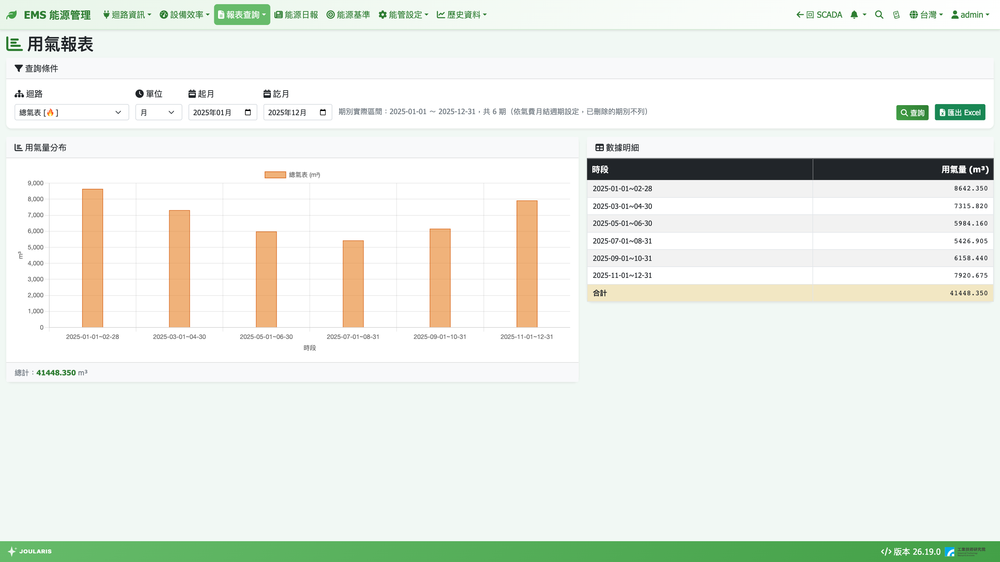
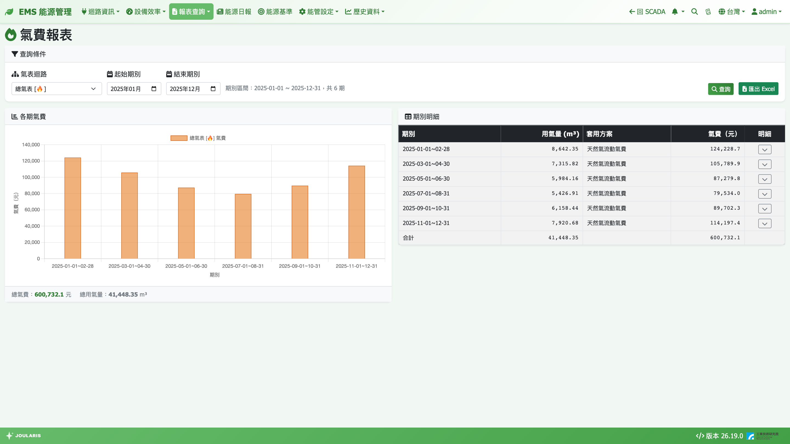

# 用氣與氣費報表

這一章包含兩個頁面：**用氣報表** 查詢天然氣用量（m³），**氣費報表** 依您設定的氣費級距逐期試算氣費。

## 如何進入

- 導覽列 **報表查詢 → 用氣報表**
- 導覽列 **報表查詢 → 氣費報表**

## 用氣報表

### 畫面說明

- **查詢條件**：**迴路**、**單位**（**時** / **日** / **月** / **年** / **班別**）、起訖時間、**查詢**、**匯出 Excel**
- **用氣量分布**：長條圖，下方顯示 **總計**
- **數據明細**：**時段** / **用氣量 (m³)**，最後一列 **合計**

### 查詢步驟

1. 選 **迴路**（最上層通常就是全廠用氣）
2. 選 **單位** 並填起訖時間
3. 按 **查詢**
4. 需要存檔時按 **匯出 Excel**（選上層迴路時，每個直接子迴路多一欄）

**顯示明細** / **顯示合計** 切換與 **班別** 單位的用法，與 [用電報表](energy-report) 相同。

### 「月」是氣費期別，可能兩月一期

用氣報表的「月」依 [月結週期](billing-period) 中的**氣費期別**切分，與電費、水費期別各自獨立。

許多供氣業者是**兩個月抄表一次**。若在氣費月結週期中把某些月份「刪除」組成兩月一期，查詢一整年的月單位時只會出現 **6 列**，而不是 12 列。月單位下方的提示會寫出「期別實際區間 … 共 N 期（依氣費月結週期設定，已刪除的期別不列）」，方便確認。

### 讀數說明

- 1 度 = 1 m³；氣表若以公升計，系統會自動換算成 m³
- 系統不做熱值（kcal）換算，若帳單是以熱值計價，需另行換算
- 用氣量每小時整點後幾分鐘彙整
- 表格某格出現「此區間氣表資料不完整（可能斷線）」時，代表該時段有氣表斷線

## 氣費報表

### 畫面說明

- **查詢條件**：**氣表迴路**、**起始期別**、**結束期別**、**查詢**、**匯出 Excel**；下方顯示「期別區間 … 共 N 期」
- **各期氣費**：每期一根柱；上方顯示 **總氣費** 與 **總用氣量**
- **期別明細**：**期別** / **用氣量 (m³)** / **套用方案** / **氣費（元）** / **明細**

### 查詢步驟

1. 選 **氣表迴路**
2. 選 **起始期別** 與 **結束期別**
3. 按 **查詢**
4. 按某期 **明細** 欄的展開鈕，看各級距的 **級距（度）**、**單價（元/度）**、**度數 (m³)**、**金額（元）**
5. 按 **匯出 Excel** 存檔（資料不完整的期別會在期別欄加「*」）

### 氣費怎麼算

- 每期總用氣量套用 [費率設定](tariff) 中的氣費級距，分段累進計算
- 天然氣沒有全國統一費率，系統預設是一張空白範本，**請依您與供氣業者的合約帳單自行填入級距與單價**
- 每一期採用「該期起始日當天有效」的方案版本，調整費率不會改寫歷史各期
- 被刪除（兩月一期）的期別不會出現在報表中

> 💡 提示：若設為兩月一期，費率級距請直接照帳單上「一期」的數字填寫，系統不會自動乘以 2。

> ⚠️ 注意：氣費報表只算**流動氣費**，不含基本費。

## 常見狀況

| 狀況 | 原因與處理 |
|------|-----------|
| 迴路下拉沒有選項 | 先到 [氣表/迴路設定](gas-meter-setting) 建立迴路 |
| 氣費全部是 0 | 尚未填入氣費級距單價，請到 [費率設定](tariff) 依合約填寫 |
| 一年只有 6 期 | 氣費月結週期設成兩月一期，屬正常 |
| 期別欄出現 **資料不完整** | 該期有氣表斷線，金額僅供參考 |
| 氣表設定頁找不到要綁的點位 | 屬設定問題，請參考 [氣表/迴路設定](gas-meter-setting) |
