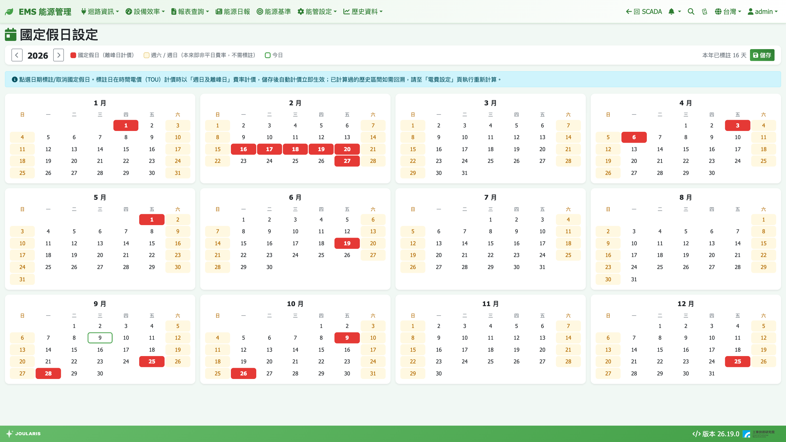
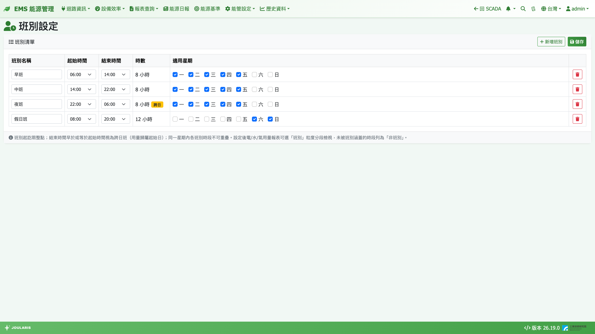

# 國定假日與班別

這兩頁都在 **能管設定 → 設定** 子選單下：

| 設定頁 | 選單路徑 | 用途 |
|--------|----------|------|
| **國定假日設定** | **能管設定 → 設定 → 國定假日設定** | 標註國定假日 / 離峰日，影響時間電價計費與能源日報的假日提示 |
| **班別設定** | **能管設定 → 設定 → 班別設定** | 定義早 / 中 / 晚班，供電、水、氣用量報表依班別分段檢視 |

## 國定假日設定

### 用途

台電時間電價的「**週日及離峰日**」費率，除了週日以外也適用於國定假日等離峰日。在本頁標註的日子，計算電費時一律以 **週日及離峰日** 的時段與單價計價。

判定順序（假日優先於星期）：

1. 有標註 → 週日及離峰日
2. 週六 → 週六
3. 週日 → 週日及離峰日
4. 其他 → 週一至週五

> 💡 提示：只有**時間電價**方案會受影響；累進與單一費率方案不分日別，標不標註都一樣。

另外，[能源日報](daily-report)也會參考本頁判斷報告日是否為假日，用於假日徽章與「比較基準不同」的提示。

### 畫面說明

- 整年 12 個月年曆，上方左右箭頭切換年份
- 圖例：**國定假日（離峰日計價）** 紅底、**週六 / 週日** 淡黃底、**今日** 綠框
- 工具列顯示「本年已標註 N 天」，有修改未存時顯示「有未儲存的變更」

### 標註假日的步驟

1. 切換到要設定的年份
2. 在年曆上**點一下日期**即標註（變紅底），再點一次取消
3. 標完整年後按 **儲存**（整年一次存入）

> 💡 提示：週六、週日本來就不是平日費率，**不需要標註**。補班日（週六上班）台電仍按週六計價，一般也不需處理。

- 系統沒有自動匯入行事曆，**每年請手動標註一次**（建議年初依行政院辦公日曆表設定）
- 標註不分種類，國定假日、彈性放假、台電離峰日都用同一種標記
- 尚未儲存就切換年份或離開頁面時，會提醒放棄變更

### 對電費的影響

> ⚠️ 注意：儲存後只影響**之後**的自動計價。已計算過的歷史電費**不會自動更新**，如需回溯，請到[費率設定 § 重新計算電費](tariff)執行重新計算（選擇涵蓋這些假日的區間）。

## 班別設定

### 用途

定義工廠的班別後，[用電報表](energy-report)、[用水報表](water-report)、[用氣報表](gas-report)的粒度下拉會多一個「**班別**」選項，報表每一列 = **日期 × 班別**，方便比較各班的能耗。

### 畫面說明

**班別清單** 欄位：**班別名稱**、**起始時間**、**結束時間**、**時數**、**適用星期**（一～日勾選），跨日的班會標示 **跨日**。

### 新增班別的步驟

1. 按 **新增班別**
2. 輸入 **班別名稱**（例如「早班」）
3. 選 **起始時間** 與 **結束時間**（限整點）
4. 勾選 **適用星期**（至少一天）
5. 依需要重複新增，全部完成後按 **儲存**；要移除某班按該列 **刪除** 後再儲存

### 規則

- 起訖**只能是整點**，不支援 07:30 這類半點交班
- **結束時間早於或等於起始時間 = 跨日班**，例如 22:00～06:00
- 跨日班的用量**整段歸在起始那一天**（週一 22:00～週二 06:00 算在週一晚班）
- 同一週內各班別的時段**不可重疊**（含跨日溢到隔天的部分），否則無法儲存
- 名稱不可重複
- 班別只看星期，**不考慮國定假日**

### 報表上的「非班別」

每天沒有被任何班別涵蓋的時段，會合併成一列「**非班別**」。各班別加上非班別，總量可與日報表對帳。

> 💡 提示：查詢範圍的第一天，若凌晨時段屬於「前一天開始的跨日班」，該段會歸到前一天、不列入本次結果；最後一天的跨日班則整段計入。因此有跨日班時，班別合計與同範圍日總量在頭尾兩天可能略有差異。

### 修改班別的影響

班別只是報表的「切法」，不影響計價。修改後**所有歷史查詢立即改用新班表**，系統不保存舊班表。若全部班別都刪除，報表選「班別」粒度時會提示尚未設定班別。
