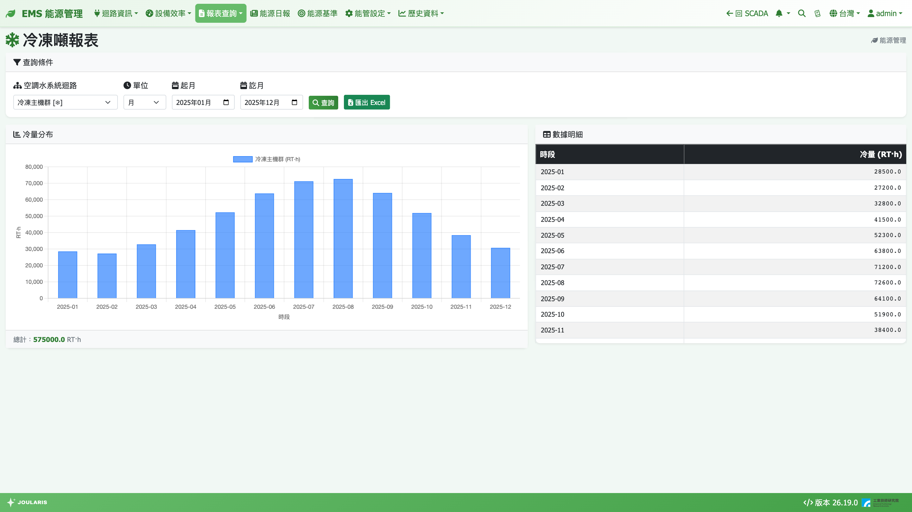

# 冷凍噸報表

冷凍噸報表查詢空調水系統（冰水主機）在一段期間內產生的**冷量**，單位為 RT·h（冷凍噸小時）。可用來了解空調負載的季節變化，也是計算「每冷凍噸耗電」的基礎。

## 如何進入

導覽列 **報表查詢 → 冷凍噸報表**

## 什麼是 RT·h

- **RT（冷凍噸）**：冷房能力的單位，1 RT ≈ 3.517 kW 的冷量
- **RT·h（冷凍噸小時）**：冷量 × 時間。例如主機穩定提供 500 RT 運轉 2 小時 = 1,000 RT·h

系統每小時把冰水主機的 RT 讀值取平均 × 1 小時，得到該小時的 RT·h，再依您查詢的區間加總。讀到負值的時刻會視為 0（沒有產生冷量）。

> ⚠️ 注意：這裡的「空調水系統」是冰水主機冷量，與自來水表的用水量無關。

## 畫面說明

- **查詢條件**：**空調水系統迴路**、**單位**（**時** / **日** / **月** / **年**）、起訖時間、**查詢**、**匯出 Excel**
- **冷量分布**：長條圖，下方顯示 **總計**（RT·h）
- **數據明細**：**時段** / **冷量 (RT·h)**，最後一列 **合計**

## 查詢步驟

1. 在 **空調水系統迴路** 選擇迴路（可選上層合計或單台主機）
2. 選 **單位** 並填起訖：時（起時 / 訖時）、日（起日 / 訖日）、月（起月 / 訖月）、年（起年 / 訖年）
3. 按 **查詢**
4. 需要存檔時按 **匯出 Excel**

### 顯示明細 / 顯示合計

選到底下有多個子迴路的上層迴路時，圖表右上角會出現 **顯示明細**，可切換成堆疊長條，看各台主機或各子系統的貢獻；按 **顯示合計** 切回。

## 「月」固定為曆月

冷凍噸報表的「月」**一律是每月 1 號到月底**，不受任何月結週期設定影響。這樣它的數字會與 [能源申報](energy-declaration) 及 [迴路資訊](circuit-info) 的空調水系統頁完全一致。

## 讀數說明

- 上層迴路 = 底下所有主機加總（空調水系統沒有「扣除」的設定，一律相加）
- 數值顯示到小數一位
- 冷量資料每小時整點後幾分鐘彙整一次，查今天時最近一小時可能尚未算入

## 常見狀況

| 狀況 | 原因與處理 |
|------|-----------|
| 迴路下拉顯示「尚未設定空調水系統迴路」 | 先到 [空調水系統迴路設定](chilled-water-system) 建立迴路 |
| 出現「⚠ 部分時段資料不足（樣本數 < 30/小時），該段視為缺資料」 | 某小時內有效讀數少於 30 筆（約半小時以上沒資料），該小時不計入。請檢查主機 RT 點位的通訊 |
| 冬天某些天冷量為 0 | 主機停機，屬正常 |
| 與用電報表一起算 kWh/RT·h 時月份對不上 | 用電報表的月是電費期別，冷凍噸報表是曆月。要比較效率請直接用 [能源申報](energy-declaration)，兩邊都是曆月 |
