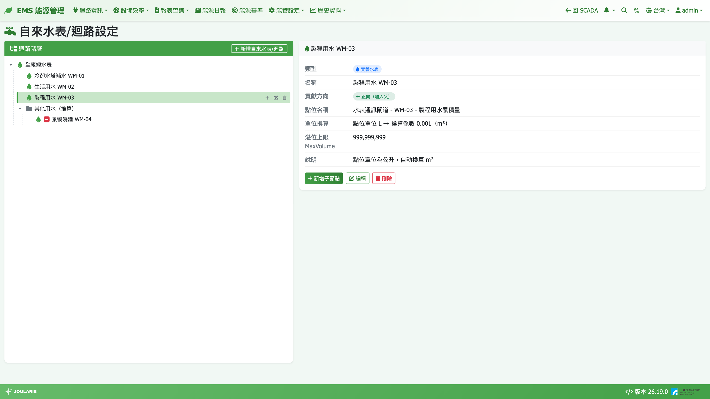

# 自來水表/迴路設定

本頁用來建立**自來水用水的水表 / 迴路階層**。用水報表、水費報表、EMS 首頁的用水量與水費卡片、自來水迴路資訊、能源日報的用水時報表，都依這棵樹加總。

**進入方式**：**能管設定 → 自來水表 → 自來水表/迴路設定**

> ⚠️ 注意：本頁處理**累積式水表**（讀數一直往上累加的 m³ 或公升水表），與[空調水系統迴路設定](chilled-water-system)的冷凍噸完全無關。

## 基本觀念

本頁的樹與[電表/迴路設定](electricity-meter-setting)的觀念相同，差異如下：

| 項目 | 自來水表 |
|------|----------|
| 節點類型 | **虛擬迴路** / **實體水表** |
| 可綁的點位 | 單位為 m³ 系或公升（L）系的累積點位 |
| 單位換算 | 公升點位自動換算成 m³，**報表一律以 m³ 顯示** |
| 溢位處理 | **溢位上限 MaxVolume**（以點位原始單位填寫） |
| 貢獻方向 | 有，**正向（加入父）** / **反向（從父扣減）** |
| 最上層節點 | **只能有一個**（代表全廠） |

- EMS 首頁的「全廠用水」= 最上層那個節點的加總，所以全廠只建一棵樹
- 水費計價時，水費 1 度 = 1 m³

## 畫面說明

- **左側「迴路階層」**：樹狀清單，滑鼠移到節點上出現 **新增子節點** / **編輯** / **刪除**；反向節點有紅色 **−** 標記
- **右上「新增自來水表/迴路」**：建立最上層（全廠）節點
- **右側詳情區**：類型、名稱、貢獻方向、點位名稱、單位換算、溢位上限 MaxVolume、說明

## 新增水表節點

1. 第一次使用時，按 **新增自來水表/迴路** 建立全廠根節點，例如「全廠總水表」
2. 在根節點上按 **新增子節點** 建立下層
3. 輸入 **名稱**（例如「冷卻塔補水」），選 **節點類型**
4. 選擇 **貢獻方向**（根節點不適用）
5. 選 **實體水表** 時：
   1. 按 **選擇點位**，左邊選 **通訊設備**、右邊選 **點位**（可搜尋點位名稱 / SID），按 **確定**
   2. 選定後畫面會顯示「點位單位 … → 換算係數 …（m³）」，確認換算正確
   3. 視需要填 **溢位上限 MaxVolume**
6. 按 **儲存**

> 💡 提示：點位清單只列出單位為 m³ / L 系的累積點位。單位標成「度」的點位**不會出現**（避免和電度混淆），請先請工程師把水表點位單位改成 m³。

### 溢位上限 MaxVolume

水表讀數到上限會歸零時，把上限值填在這裡（**以點位原始單位計**，例如點位是公升就填公升數），系統才能正確算出跨越歸零的用水；留空表示不處理溢位，讀數倒退的那個小時會以 0 計並記警告。

## 拖曳搬移

操作方式與[電表/迴路設定 § 拖曳搬移節點](electricity-meter-setting)相同，另有水表專屬限制：

- **最上層的全廠根節點不能拖動**
- 不能把節點拖到根節點的前後或樹的空白處（那會變成第二個根）
- 跨層搬動與放到實體水表底下前會先確認

## 刪除節點

按 **刪除** 並確認；含子節點時會再確認一次，所有子孫一併刪除。

## 注意事項

- **改結構會立即影響歷史報表**：用水報表、水費報表依目前的樹計算，搬移、刪除或改貢獻方向後，過去月份的數字也會跟著變
- 用水量每小時彙整一次，最近一小時的數字要等下一個整點過後幾分鐘才會出現
- 綁定點位時的單位換算係數在**綁定當下**決定；之後若工程師改了點位單位，請重新編輯此水表並重新選點位
- 已彙整的歷史資料不會因事後修改溢位上限而自動重算，請在初次設定時就填好
- 水費還需要設定[水費月結週期](billing-period)與[水費設定](tariff)

## 常見錯誤

| 狀況 | 原因與處理 |
|------|-----------|
| 點位清單找不到水表 | 點位單位不是 m³ / L 系（例如標成「度」或流量 m³/h），請修正點位單位或改綁累積量點位 |
| 儲存時出現「實體水表必須綁定水量點位」 | 選了實體水表但未選點位 |
| 拖曳時出現「只允許一個全廠根節點」 | 不能把節點搬成第二個根，請放到全廠節點底下 |
| 用水報表某時段標示資料不完整 | 水表在該時段斷線，缺資料那段不計入 |
