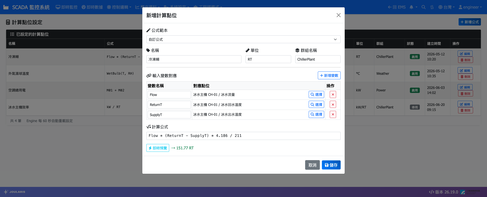

# 計算點位

計算點位以公式從其他點位衍生出新的數值，例如功率 = 電壓 × 電流、平均溫度、COP、冷凍噸、濕球溫度。計算結果和一般點位一樣會存歷史、推播即時值，可以設警報、畫趨勢、綁到監控畫面，也可以再被其他計算點位引用。

## 基本觀念

- **SID 格式 `CALC-S{N}`**，例 `CALC-S3`
- **輸入變數**：公式中的每個變數名稱對應一個點位，可選 Modbus、DB 來源、OPC UA、需量點位或其他計算點位
- **計算時機**：輸入點位有新數值時即時計算
- **設定生效**：存檔後 Engine 最多約 60 秒內自動重新載入，不需重啟
- **群組名稱**：用來在點位選擇器中分群；也是 MQTT 推播主題的中間一段（未填時為 `Calculated`）

## 進入頁面

選單：**工程師模式 → 點位設定 → 計算點位**

頁面列出 **已設定的計算點位**，欄位有 **名稱**、**公式**、**單位**、**群組**、**狀態**、**建立時間**、**操作**（**編輯** / **刪除**）。

## 新增計算點位

1. 按 **新增公式**
2. **公式範本**：一般選 **自訂公式**；需要空調常用計算時可選範本，會自動帶入名稱與公式：
   - **濕球溫度（Stull 經驗式）** → `WetBulb(T, RH)`
   - **焓值（濕空氣比焓）** → `Enthalpy(T, RH)`
   - **露點溫度（Magnus 式）** → `DewPoint(T, RH)`
3. 填 **名稱**（例：冷凍噸）、**單位**（例：RT）、**群組名稱**（例：ChillerPlant）
4. 在 **輸入變數對應** 按 **新增變數**，輸入 **變數名稱**（例：`Flow`），按 **選擇** 指定 **對應點位**
5. 依需要重複步驟 4
6. 在 **計算公式** 輸入公式，例：`Flow * (ReturnT - SupplyT) * 4.186 / 211`
7. 按 **即時預覽**，以各點位目前的值試算一次，確認結果合理
8. 按 **儲存**

> 💡 提示：公式可以只有常數、不需要輸入變數（例如固定的基準值），這時不必新增變數。

### 點位選擇器

按 **選擇** 後依序選：

1. **選擇點位來源**：**設備點位**（Modbus）、**計算點位**、**DB 來源點位**（含氣象 Weather）、**OPC UA 點位**、**需量點位**（電表迴路 15 分鐘需量 kW）
2. **選擇設備** 或群組
3. **選擇點位**（可用 **搜尋點位名稱…** 篩選），按 **確認選擇**

## 公式語法

| 類別 | 可用寫法 |
|------|---------|
| 運算子 | `+`、`-`、`*`、`/`、`%` |
| 比較 | `>`、`<`、`>=`、`<=`、`==`、`!=` |
| 條件 | `if(條件, 真值, 假值)` |
| 數學 | `Pow(x,y)`、`Sqrt(x)`、`Abs(x)` |
| 空調專用 | `WetBulb(T, RH)`、`Enthalpy(T, RH)`、`DewPoint(T, RH)` |

邏輯運算：`&&`（且）、`||`（或）、`!`（非）。

公式範例：

| 名稱 | 公式 | 說明 |
|------|------|------|
| 功率 | `V * I / 1000` | 電壓 × 電流 ÷ 1000 |
| 平均溫度 | `(T1 + T2) / 2` | 兩點平均 |
| COP | `Qc / P` | Qc 可引用另一個計算點位 |
| 運轉判斷 | `if(A > 5, 1, 0)` | 電流大於 5A 視為運轉 |

空調專用函數的適用範圍：乾球溫度 T 為 0～50°C；相對濕度 RH 濕球 5～100%、焓值 0～100%、露點 1～100%。超出範圍時結果標示為 Bad。

> ⚠️ 注意：變數名稱不可與內建函數同名（如 `WetBulb`、`Enthalpy`、`DewPoint`），儲存時會被擋下並提示改名。

## 品質判定

| 情況 | 結果 |
|------|------|
| 所有輸入點位正常 | 正常計算 |
| 某個輸入點位找不到 | 結果標示 Bad（該變數以 0 代入） |
| 計算結果為無限大或非數字（例如除以 0） | 結果標示 Bad |
| 公式語法錯誤 | 該計算點位略過，Engine log 記錄「計算點位 SID 計算失敗」 |

## 修改與刪除

- **編輯**：可改名稱、單位、群組、變數與公式；SID 不變，歷史延續
- **刪除**：確認後刪除設定，**歷史資料仍會保留**；但引用它的警報、畫面元件、其他計算點位會失去來源，請先檢查

> ⚠️ 注意：被其他計算點位引用的計算點位，刪除後下游會變成 Bad。刪除前請先在列表中搜尋公式是否引用了它的 SID。

## 與其他功能的關係

- **對外 Modbus Gateway**：啟用中的計算點位會配到 Gateway 的計算點位段位址，見 [對外 Modbus TCP Gateway](modbus-gateway)
- **MQTT**：推播主題為 `SCADA/Realtime/{群組名稱}/{SID}`，見 [MQTT 即時資料訂閱](mqtt-integration)
- 需要時序邏輯（延時、計數、排程、演算法）而不只是即時公式時，改用 [流程圖控制與演算法](logic-flow)
