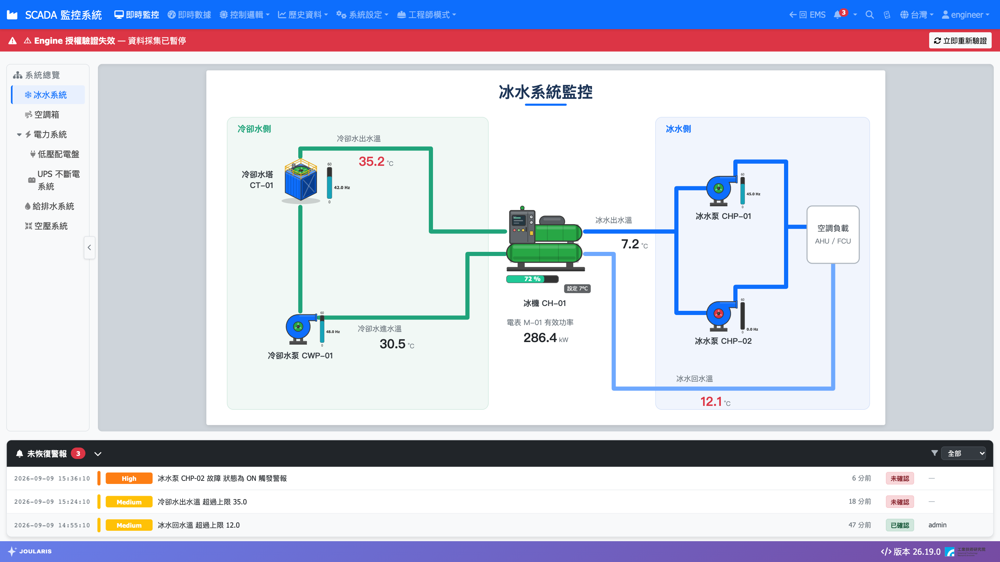

# 授權加密狗

系統以 HASP（Sentinel）USB 加密狗做軟體授權。未插加密狗或授權內容不符時，Engine 會**暫停資料採集**，網頁頂端出現紅色警示橫幅。

## 運作方式

```
HASP USB 加密狗
   ↑ 讀取授權
License Bridge 服務（JoularisLicense）
   ↑ 本機 Named Pipe
Engine（JoularisEngine）每 30 分鐘驗證一次
   ├─ 驗證失敗 → 暫停 Modbus / DB / OPC UA 採集
   ├─ 驗證恢復 → 自動恢復採集
   └─ 結果以 MQTT 發布 SCADA/Sys/License/Status
          ↓
Web 每 30 秒查詢狀態 → 失效時顯示紅色橫幅
```

- Engine 啟動約 5 秒後立即驗證一次，之後每 30 分鐘重驗
- HASP 執行庫需要 .NET Framework 4.8（32 位元），因此獨立成 License Bridge 服務，與 Engine 以本機 Named Pipe 溝通
- 授權只綁 Engine；Web 不驗授權，授權失效時仍可登入查歷史資料

| 項目 | 內容 |
|------|------|
| 服務名 | `JoularisLicense`（顯示名 JOULARIS License Bridge） |
| 安裝位置 | `C:\JOULARIS\LicenseBridge\` |
| Log | `C:\JOULARIS\LicenseBridge\Log\bridge-{日期}.log`（保留 7 天） |

## 安裝

`Install.bat` 步驟 [4/8] 會自動安裝 License Bridge 並建立服務。現場**只有兩件事要人工處理**：

1. 在伺服器插上 HASP USB 加密狗
2. 必要時安裝 Sentinel / HASP 驅動（離線安裝：`haspdinst.exe -i`）

前置需求是 .NET Framework 4.8；`Install.bat` 開頭會檢查，缺少時中止安裝。

## 授權失效時的畫面

所有頁面頂端出現紅色橫幅：

**⚠ Engine 授權驗證失效 — 資料採集已暫停**，右側有 **立即重新驗證** 按鈕。



此時：

- Modbus、DB 來源、OPC UA 採集暫停，即時值不再更新
- 依賴即時值的警報、計算點位、流程圖控制也跟著停擺
- 歷史資料、報表等查詢功能照常可用

## 排除步驟

1. 確認加密狗插在伺服器上，指示燈有亮
2. 確認 License Bridge 服務正在執行：`sc query JoularisLicense`，未執行則 `net start JoularisLicense`
3. 回到網頁按 **立即重新驗證**（按鈕會顯示「驗證中...」，約 5 秒後重新查詢狀態）
4. 橫幅消失即恢復；Engine 會自動恢復採集，不需重啟
5. 仍失敗時查看 `LicenseBridge\Log\bridge-*.log` 中的失敗原因，以及 Engine log

> 💡 提示：**立即重新驗證** 是透過 MQTT 通知 Engine 立刻驗證，不必等 30 分鐘週期。若按下後提示失敗，表示 Web 連不上 MQTT broker，請先確認 broker 服務。

> 💡 提示：Engine 若發現 License Bridge 服務不存在，會嘗試自行建立 `JoularisLicense` 服務。

## 常見狀況

| 狀況 | 原因 / 處理 |
|------|------------|
| 加密狗有插，橫幅仍在 | License Bridge 未執行、HASP 驅動未安裝，或加密狗內的授權碼不符（查 bridge log） |
| 換 USB 孔或拔插後仍失效 | 按 **立即重新驗證**，不必等下一次 30 分鐘驗證 |
| License 服務啟動失敗 | 目標機缺 .NET Framework 4.8，或服務被設為停用（重跑新版 `Install.bat` 會改回自動啟動） |
| 升級後 Engine / Web 停止，但 License 正常 | 與授權無關，多半是缺 ASP.NET Core Runtime 8，見 [部署與升級](deployment) |
| 加密狗遺失或損壞 | 請聯絡原廠補發；期間採集會暫停 |
