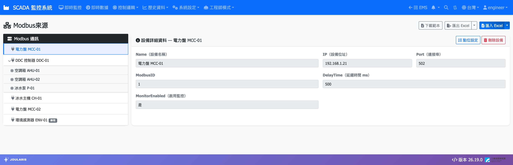
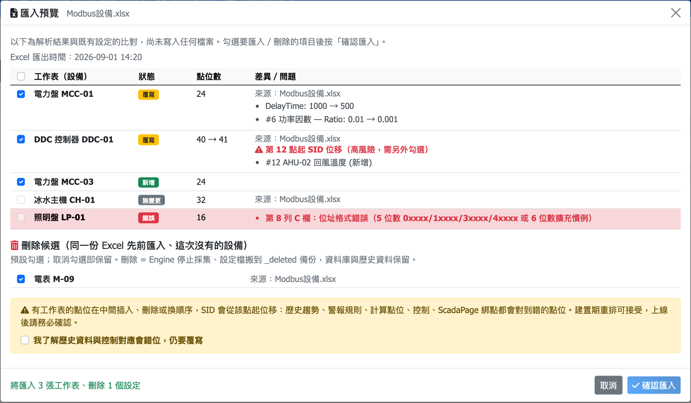

# Modbus 來源

本章說明如何用 Excel 範本建立 Modbus TCP 設備、在網頁上微調點位，以及刪除設備。Modbus 是現場最主要的資料來源，Engine 依設定週期讀取設備暫存器，換算成工程值後寫入歷史、即時值並推播給其他功能。

## 基本觀念

- **一份設定檔 = 一台設備（一條連線）**：存放在 `C:\JOULARIS\Engine\App\Modbus\{設備名稱}.json`，檔名就是設備名稱。同一個 IP:Port（例如同一台 Gateway 下的電表、流量計、露點計）可以分成多份設定檔，各自獨立連線
- **設定檔是唯一真相，Excel 只是檢視**：網頁匯入 Excel 時，系統把 Excel 轉成 JSON 寫進上述資料夾；伺服器不保存你上傳的 Excel
- **免重啟**：Engine 監看該資料夾，檔案變動後數秒內自動重新載入，該設備會斷線重連一次（約 1～3 秒）；只影響變動的那份設定檔，一次匯入多份也一樣
- **SID 依點位順序產生**：每個點位的識別碼由「設備 + 站號 + 第幾個點位」決定。歷史資料、警報規則、計算點位、畫面綁定都靠 SID 對應，**點位順序一旦上線就不要再改**

> ⚠️ 注意：在 Excel 中**新增點位一律加在最後一列**。在中間插入、刪除或調換順序，該點之後所有點位的 SID 都會位移，歷史趨勢、警報、控制與畫面綁定會對到錯的點位。

## 進入頁面

選單：**工程師模式 → 點位設定 → Modbus來源**

畫面分為：

- **頁首工具列**：**下載範本**、**匯出 Excel**、**匯入 Excel**
- **左側「Modbus 通訊」清單**：所有已載入的設備；多站號設備會展開各站號子項
- **右側「設備詳細資料」**：**IP（設備位址）**、**Port（連接埠）**、**Name（設備名稱）**、**ModbusID**、**DelayTime（延遲時間 ms）**、**MonitorEnabled（啟用監控）**，以及 **點位設定**、**刪除設備** 按鈕

清單上的徽章：

| 徽章 | 意義 |
|------|------|
| **停用** | 設備的監控開關關閉 |
| **設定檔已移除** | 資料庫有這台設備的紀錄，但設定檔已刪除；Engine 已停止採集，歷史資料保留 |
| **待 Engine 載入** | 設定檔已匯入，但 Engine 還沒把它寫進資料庫（見「常見狀況」） |

## 準備：填寫 Excel 範本

1. 按 **下載範本** 取得 `Modbus範本.xlsx`（Release 包的 `Engine\App\Modbus\` 內也有一份）
2. **一張工作表 = 一台設備**，工作表名稱就是設備名稱。一份 Excel 可放多張工作表（建議一盤或一台 Gateway 一份 Excel）
3. 第 1 列填設備參數：**IP**、**Port**（空白 = 502）、**ModbusID**（多個站號以逗號分隔，如 `1,2,3`）、**ConnectTimeout**（空白 = 1000 ms）
4. 第 3 列起每列一個點位：

| 欄 | 內容 | 說明 |
|----|------|------|
| A | Name | 點位名稱，必填；名稱空白的列會略過 |
| B | Address | 暫存器位址，見下表 |
| C | DataType | 資料型態（下拉選單） |
| D | Ratio | 倍率，工程值 = 原始值 × Ratio |
| E | Unit | 單位，如 `kWh`、`°C` |
| F / G | Min / Max | 顯示與控制範圍，可留空 |
| H | Device | 子設備名稱，可留空（見「子設備分群」） |

### 位址寫法

| 5 位數 | 6 位數（擴充） | 類型 | 功能碼 |
|--------|---------------|------|--------|
| `1`～`9999` | `000001`～`065536` | Coil（DO，可寫） | FC01 |
| `1xxxx` | `1xxxxx` | Discrete Input（DI） | FC02 |
| `3xxxx` | `3xxxxx` | Input Register | FC04 |
| `4xxxx` | `4xxxxx` | Holding Register（可寫） | FC03 |

> ⚠️ 注意：前導 0 有意義。`045000` 是 Coil、`45000` 是 Holding Register。Address 欄請保持文字格式，避免 Excel 吃掉前導 0。

### 資料型態

| 型態 | 暫存器數 | 說明 |
|------|---------|------|
| `INTEGER` / `UINTEGER` | 1 | 有號 / 無號 16 位元整數 |
| `FLOATINGPT` | 2 | 32 位元浮點，低字組在前（CDAB） |
| `SWAPPEDFP` | 2 | 32 位元浮點，高字組在前（ABCD） |
| `DOUBLE` / `SWAPPEDDOUBLE` | 4 | 64 位元浮點（字組順序同上） |
| `UINT32BE` | 2 | 無號 32 位元整數（ABCD） |
| `DEC10K3` | 3 | 三段 0～9999 十進位組合：R0×10000 + R1 + R2×0.0001 |
| `BCD` | 1 | 4 位 BCD 碼 |
| `BIT0`～`BIT15` | 1 | 取該暫存器的第 n 位元，回傳 0 / 1 |

> ⚠️ 注意：`BIT` 型態只能配 `3xxxx` / `4xxxx` 位址；`DEC10K3`、`BCD`、`BIT` 三種型態只能讀、不能控制寫入。浮點數讀出來數值怪異時，多半是 `FLOATINGPT` / `SWAPPEDFP` 選反。

## 匯入 Excel

1. 按 **匯入 Excel** 上傳 `.xlsx`（舊的 `.xlsm` 巨集檔也可直接上傳）
2. 系統顯示 **匯入預覽**，此時**尚未寫入任何檔案**。每張工作表一列：

| 狀態 | 意義 | 預設 |
|------|------|------|
| **新增** | 這台設備原本不存在 | 勾選 |
| **覆寫** | 設備已存在且內容有差異，**差異／問題** 欄列出「欄位: 舊 → 新」 | 勾選 |
| **無變更** | 內容相同 | 不可勾 |
| **錯誤** | 格式錯誤，紅字指出工作表、列、欄與原因 | 不可勾 |

3. 下方 **刪除候選** 列出「同一份 Excel 先前匯入、這次沒有的設備」，預設勾選；取消勾選即保留
4. 確認勾選後按 **確認匯入**，有覆寫或刪除時會再跳確認框列出設備名稱
5. 寫入後頁面等待 Engine 載入（最多約 20 秒）再自動重新整理

### 預覽中的兩種高風險警告

- **SID 位移**：某張工作表在中間插入、刪除或調換點位，會顯示「第 N 點起 SID 位移」，必須另外勾選 **我了解歷史資料與控制對應會錯位，仍要覆寫** 才能提交。建置期可接受，上線後請務必確認
- **覆寫網頁修改**：這份 Excel 是在「網頁上改過點位」之前匯出的（或是範本、手工建立），匯入會蓋掉網頁上的修改，須勾選 **我了解會覆寫網頁上的修改，仍要匯入**。建議取消，先 **匯出 Excel** 拿最新版再改

> 💡 提示：最安全的流程是「先匯出 → 在 Excel 修改 → 再匯入」。這樣預覽只會列出你真正改的地方，也不會觸發覆寫警告。

> 💡 提示：預覽整份都不能勾選時（例如上傳了沒填 IP 的空白範本），頂部會以黃底說明原因，修正 Excel 後重新上傳即可。

## 匯出 Excel 與來源資料夾

- **匯出 Excel** 主按鈕會把現行設定寫進 Engine 的來源資料夾（`C:\JOULARIS\Engine\App\Modbus\`）：全部設備 → `Modbus設定.xlsx`；**依來源 Excel 檔匯出** → 沿用原檔名。覆寫前一份時留 `.bak`
- 下拉選 **下載到瀏覽器** 可把檔案下載到你的電腦（從遠端電腦操作時用）
- **匯入 Excel** 下拉的 **從來源資料夾匯入** 可直接選資料夾內的 Excel，不必經瀏覽器上傳
- 在伺服器上用 Excel 修改並存檔後，頁面會提示「來源資料夾內的 Excel 有尚未匯入的修改」，點檔名即可開預覽

> ⚠️ 注意：在 Excel 存檔**不會**生效，Engine 只讀 JSON 設定檔，一定要回網頁匯入。匯出時若 Excel 正開著該檔，會提示「請先關閉 Excel 再匯出」。

## 在網頁上微調點位（點位設定）

不需動到 Excel 的小修改（改名、改單位、改倍率）可直接在網頁完成：

1. 左側選設備，按右側 **點位設定**
2. 視窗內可編輯 **名稱**、**位址**、**資料型態**、**倍率**、**單位**、**下限**、**上限**、**子設備**
3. 按 **儲存點位**，確認框會列出變更數量與注意事項
4. 顯示「已儲存，Engine 將於數秒內重載」即完成

限制：

- IP、Port、ModbusId、連線逾時、檔名唯讀
- **不能新增、刪除或調換點位**（避免 SID 位移）；結構性修改請走 Excel 匯入
- 每個有變更的點位會寫一筆事件記錄（含操作者帳號與「位址: 30513 → 30514」這類摘要）

> ⚠️ 注意：改位址後 SID 不變，歷史資料會無縫接續——前後量測的是不同暫存器，屬運維責任。改名後，警報、趨勢、即時數據會自動顯示新名；但**畫面設計的元件標題與流程圖節點標籤不會自動改**，需到該頁重新綁定。

## 子設備分群（Device 欄）

一顆 PLC（單一站號）裡放多台設備時，可在 **Device** 欄（或網頁 **子設備** 欄）標註點位屬於哪台設備。之後在畫面設計、流程圖、計算點位的點位選擇器中可依子設備展開瀏覽，畫面設計的設備級自動綁定也以此為設備邊界。

- **多站號設備**（ModbusID 為 `1,2,3`）：一個站號就是一台設備，Device 欄不適用（網頁顯示 **不適用**）；站號名稱在右側 **名稱** 欄輸入後按 **儲存名稱**
- **單站號設備**：可為每個點位填 Device；留白 = 未分群

## 刪除設備

1. 左側選設備，按 **刪除設備** 並確認
2. 設定檔移到 `Modbus\_deleted\{名稱}_{時間}.json`，Engine 停止採集
3. 資料庫紀錄與歷史資料**保留**；之後重新匯入同名工作表，SID 不變、歷史接得上

> 💡 提示：誤刪時，把 `_deleted` 內的檔案搬回 `Modbus\` 並改回原檔名即可復原。

## 常見狀況

| 狀況 | 原因 / 處理 |
|------|------------|
| 匯入後設備一直顯示 **待 Engine 載入** | (1) 確認 Engine 服務 `JoularisEngine` 正在執行；(2) 比對 Engine 與 Web 啟動 log 的「資料庫設定檔路徑」是否同一份（應為 `C:\JOULARIS\Shared\dbSetting.json`）；(3) 查 Engine log 是否有設定驗證錯誤 |
| 某設備全部點位品質 Bad | 設備連不上：確認 IP / Port / 網路；Engine 會以「連線逾時 × 20」的間隔自動重連 |
| 單一點位讀不到、後面點位 SID 錯開 | 該點驗證失敗被跳過（如 BIT 配了 Coil 位址），修正後重匯 |
| 工作表改了名稱 | 系統會視為「新增一台 + 刪除舊的」，建立新設備編號，歷史不會接上；預覽會提示「可能是改名」 |
| 名稱超過 31 字或含 `[ ] : * ? / \` | 無法當工作表名稱，匯出時會列在「以下設定未納入」 |
