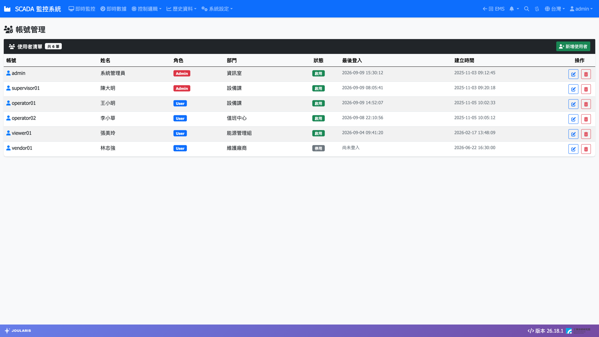
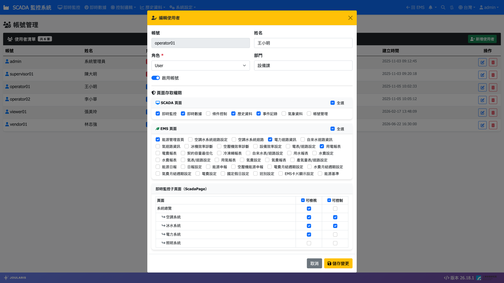

# 帳號管理

**帳號管理** 用來建立與維護系統的登入帳號，並設定每位一般使用者可以使用哪些頁面、可以檢視或控制哪些監控畫面。

> ⚠️ 注意：本頁僅 **Admin**（管理員）與 **Engineer**（工程師）帳號可以使用，一般使用者看不到這個選單。

## 進入頁面

點導覽列 **系統設定 → 帳號管理**。

## 角色說明

| 角色 | 適用對象 | 權限範圍 |
|------|----------|----------|
| **Admin** | 廠方管理者 | 可使用所有一般功能頁、所有監控畫面皆可檢視與控制，並可管理 Admin 與 User 帳號 |
| **User** | 一般操作人員 | 只能使用管理員逐項開放的頁面與監控畫面 |
| Engineer | 系統建置廠商的工程師 | 由工程師自行管理 |

> 💡 提示：Engineer 帳號由系統工程師自行建立與維護，Admin 在本頁看不到、也無法修改 Engineer 帳號，這是正常設計。

建議原則：只有需要管理帳號與警報設定的人給 **Admin**，其他值班與操作人員一律使用 **User** 並依職務開放權限。

## 使用者清單

清單欄位：**帳號**、**姓名**、**角色**、**部門**、**狀態**（**啟用** / **停用**）、**最後登入**、**建立時間**、**操作**。標題旁顯示總筆數。

**最後登入** 顯示 **尚未登入** 的帳號，代表建立後從未使用過。

## 新增使用者

1. 按右上角 **新增使用者**。
2. 填寫欄位：
   - **帳號**（必填）：登入用的名稱，建立後不能修改。
   - **姓名**、**部門**（選填）。
   - **密碼**、**確認密碼**（必填）：兩次須一致。可按眼睛圖示顯示密碼確認輸入內容。
   - **角色**：選 **Admin** 或 **User**。
   - **啟用帳號**：預設開啟。
3. 按 **儲存**。畫面提示「新增成功」後會自動重新整理。

> ⚠️ 注意：新建立的 **User** 帳號預設沒有任何頁面權限，登入後會看到「無權限存取」。建立後請接著依下一節設定權限。

## 設定頁面權限（User）

1. 在使用者清單中，按該帳號 **操作** 欄的鉛筆（**編輯**）圖示。
2. 確認 **角色** 為 **User**，視窗下方會出現 **頁面存取權限** 區塊。
3. 依需求勾選：
   - **SCADA 頁面**：允許進入的 SCADA 功能頁，例如即時監控、即時數據、趨勢圖、事件記錄等。可勾 **全選**。
   - **EMS 頁面**：允許進入的 EMS 功能頁。可勾 **全選**。
   - **即時監控子頁面（ScadaPage）**：逐一設定每個監控畫面的權限（見下一節）。
4. 按 **儲存變更**。

> 💡 提示：使用者下次登入後新權限才會完全生效。若對方正在使用中，請請他登出後重新登入。

### 即時監控子頁面：可檢視與可控制

**即時監控子頁面（ScadaPage）** 以表格列出工程師已發布的每一個監控畫面，每一列有兩個勾選框：

| 欄位 | 勾選後 |
|------|--------|
| **可檢視** | 該畫面會出現在使用者的 **系統總覽** 頁面樹中，可以看到即時狀態 |
| **可控制** | 可在該畫面上按控制按鈕、右鍵下達手動／自動、啟停、頻率設定等控制 |

欄位標題上的勾選框可一次全選該欄。

建議做法：

- 一般監看人員：只勾 **可檢視**。
- 有操作資格的值班人員：對負責的系統勾 **可檢視** 與 **可控制**。
- **可控制** 應搭配 **可檢視** 一起勾選，否則使用者看不到該畫面。

> 💡 提示：若表格顯示「尚無已發佈的畫面設計」，表示工程師尚未發布任何監控畫面。

> ⚠️ 注意：控制權限會直接影響現場設備安全，請只開放給受過訓練的人員。所有控制操作都會連同帳號記錄在 [事件記錄](event-log)。

### 主功能頁面與趨勢功能的連動

- 監控畫面上點位右鍵的 **歷史趨勢（開新頁）**，只有開放了趨勢圖頁權限的使用者才看得到。
- 導覽列鈴鐺的 **查看未恢復警報**，會依使用者權限前往即時監控或事件記錄頁。

## 修改使用者資料

1. 按該帳號的 **編輯** 圖示。
2. 可修改 **姓名**、**角色**、**部門**、**啟用帳號** 與權限（**帳號** 不可修改）。
3. 按 **儲存變更**。

把角色從 **User** 改為 **Admin** 後，該帳號即擁有全部一般功能權限，原本勾選的頁面權限不再需要。

## 停用帳號

人員離職、調職或暫時不需使用系統時，建議**停用**而非刪除，保留歷史操作紀錄的對應：

1. 按該帳號的 **編輯** 圖示。
2. 關閉 **啟用帳號**。
3. 按 **儲存變更**。

停用後該帳號無法登入，清單 **狀態** 顯示 **停用**。需要時再開啟即可恢復。

## 刪除帳號

1. 按該帳號的垃圾桶（**刪除**）圖示。
2. 在 **確認刪除** 視窗確認帳號名稱無誤，按 **確認刪除**。

> ⚠️ 注意：刪除無法復原。

## 重設密碼

目前畫面上沒有「重設密碼」按鈕，**編輯** 視窗也不能修改密碼。使用者忘記密碼時，可採以下方式：

- 刪除該帳號後，以相同帳號名稱重新建立並設定新密碼，再重新設定其頁面權限。
- 或洽系統工程師協助重設。

<!-- 待確認：若日後提供重設密碼功能，請更新本節 -->

## 常見狀況

| 狀況 | 處理方式 |
|------|----------|
| 新帳號登入後顯示「403 - 無權限存取」 | 尚未設定頁面權限，請依「設定頁面權限」勾選 |
| 使用者說頁面樹看不到某個監控畫面 | 編輯該帳號，在 **即時監控子頁面** 勾選該畫面的 **可檢視** |
| 使用者看得到畫面但無法控制 | 勾選該畫面的 **可控制** |
| 角色下拉選單沒有 Engineer | 正常，Engineer 帳號由工程師管理 |
| 出現「兩次輸入的密碼不一致」 | 重新輸入 **密碼** 與 **確認密碼** |
