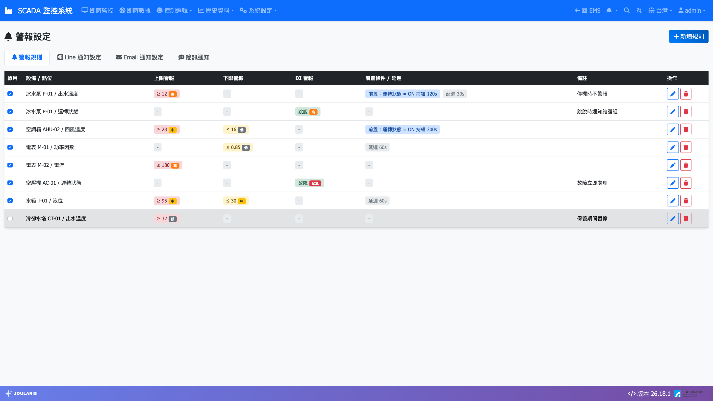
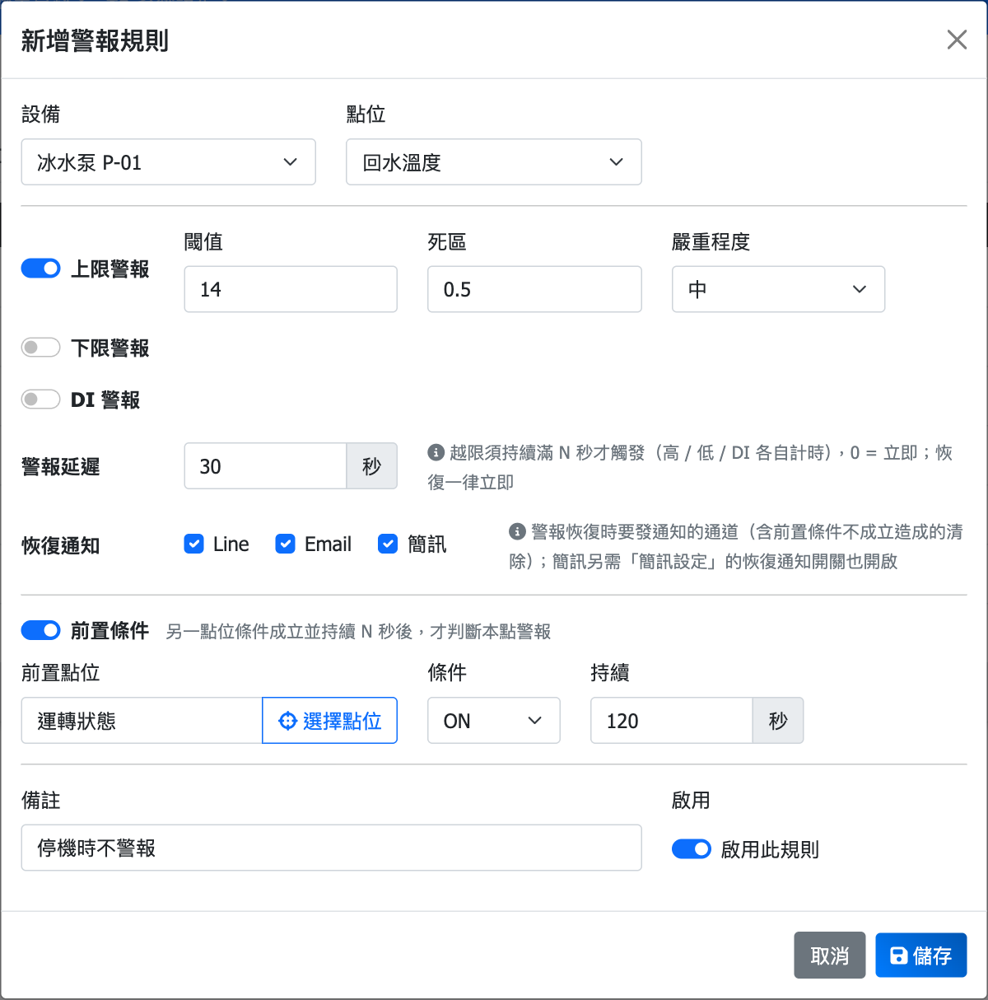
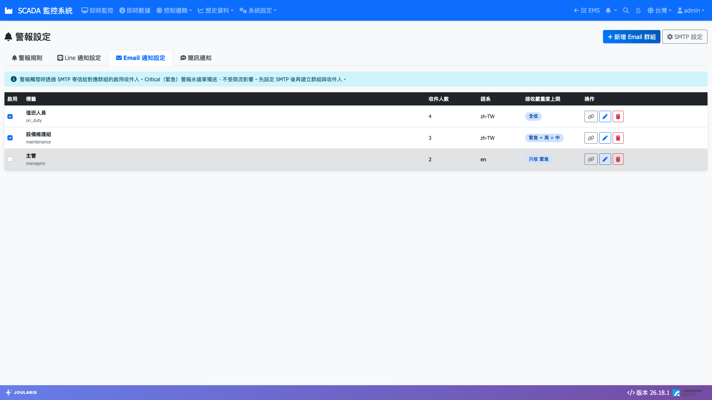

# 警報設定與通知

**警報設定** 用來決定「哪些點位在什麼情況下要發出警報」，以及「警報要通知給誰」。警報發生時，系統會：

- 在 [即時監控](scada-page) 的 **未恢復警報** 面板列出，並讓相關元件變色或閃爍。
- 讓每台登入中電腦的導覽列鈴鐺響起（依嚴重程度，見 [快速開始](quick-start)）。
- 寫入 [事件記錄](event-log)。
- 依設定推播 Line、寄送 Email、發送簡訊。

> ⚠️ 注意：新增、修改、刪除警報規則僅限 **Admin**（管理員）與 **Engineer**（工程師）帳號。

## 進入頁面

點導覽列 **系統設定 → 警報設定**。

頁面分為四個分頁：

| 分頁 | 用途 |
|------|------|
| **警報規則** | 設定各點位的上限、下限、DI 警報 |
| **Line 通知設定** | 設定要推播的 Line 群組 |
| **Email 通知設定** | 設定寄信伺服器、收件群組與收件人 |
| **簡訊通知** | 設定簡訊盒與收簡訊的手機號碼 |

右上角的按鈕會隨著目前分頁切換（例如 **新增規則**、**新增 Line 群組**）。

## 警報規則

清單欄位：**啟用**、**設備 / 點位**、**上限警報**、**下限警報**、**DI 警報**、**前置條件 / 延遲**、**備註**、**操作**。

- 直接勾選或取消 **啟用** 欄，即可立刻啟用或停用該規則，不必進入編輯。
- **操作** 欄可 **編輯** 或 **刪除** 規則。

### 新增警報規則

1. 在 **警報規則** 分頁按 **新增規則**。
2. 依序選擇 **設備**、**子設備**（有子設備時才會出現）、**點位**。計算點位、需量點位等可在設備清單中找到。
3. 依點位類型勾選要啟用的警報（可同時啟用多種）：
   - **上限警報**：數值大於等於 **閾值** 時觸發。
   - **下限警報**：數值小於等於 **閾值** 時觸發。
   - **DI 警報**：開關點位進入 **觸發狀態**（ON 或 OFF）時觸發。
4. 每種警報分別設定 **嚴重程度**：**緊急**、**高**、**中**、**低**。
5. 視需要設定 **警報延遲**、**恢復通知**、**前置條件**（說明見後文）。
6. 填寫 **備註**（選填），確認已勾選 **啟用此規則**。
7. 按 **儲存**。

每個點位只會有一條規則；對已有規則的點位再新增，會直接更新原規則。

> 💡 提示：也可以在 [即時監控](scada-page) 畫面上對點位按右鍵選 **警報設定…**，就地修改該點的規則。

### 死區：避免在門檻附近反覆警報

**死區** 是警報恢復時的緩衝量：

- 上限警報：數值須降到「閾值 − 死區」以下才算恢復。
- 下限警報：數值須升到「閾值 + 死區」以上才算恢復。

例：溫度上限 80、死區 2。溫度到 80 觸發警報，要降到 78 以下才恢復；在 79～80 之間來回跳動不會反覆觸發與恢復。

### DI 警報的 ON／OFF 標籤

DI 警報的 **ON 標籤**、**OFF 標籤** 會由監控畫面上該點位的燈號文字自動帶入（例如「運轉」「停止」），用來讓警報訊息更易讀，此處無法直接修改。

### 警報延遲

**警報延遲** 設定數值越限後須**連續持續滿幾秒**才真正發出警報；期間只要回到正常就重新計時。設為 0 表示立即警報。上限、下限、DI 各自計時；恢復一律立即。

適用情境：數值偶爾瞬間跳動、不希望一閃而過就發警報與通知。

> 💡 提示：即時監控畫面上的變色不受延遲影響——越限當下就會變色，但要滿延遲秒數才會寫入事件記錄並發送通知。

### 恢復通知

**恢復通知** 勾選警報恢復正常時，要用哪些通道（Line、Email、**簡訊**）通知。預設全部勾選。若不想收到恢復訊息，取消勾選即可；簡訊還需要 **簡訊盒設定** 中的「警報恢復時也發簡訊」同時開啟才會發送。

### 前置條件（連鎖遮蔽）

勾選 **前置條件** 後，只有在「另一個點位的條件成立並持續滿 N 秒」時，才開始判斷本點的警報。

例：泵浦剛啟動的 30 秒內出口壓力本來就偏低，不應發「壓力過低」警報。可設定：

| 欄位 | 設定 |
|------|------|
| **前置點位** | 按 **選擇點位**，選「泵浦運轉」狀態點 |
| **條件** | ON |
| **持續** | 30 秒 |

**條件** 可選 ≥、>、≤、<、=、≠（需填 **比較值**），或 ON、OFF（開關點位）。

> ⚠️ 注意：前置條件不成立時，本點**完全不會警報**，進行中的警報也會自動恢復。若規則清單出現紅色提示「前置點位不存在，警報將一直被遮蔽」，代表前置點位已被刪除，該規則等於失效，請重新選擇前置點位。

## 通知的嚴重程度範圍

Line 群組、Email 群組與簡訊號碼都各自設定 **接收嚴重度上限**，決定要收哪些等級的警報：

| 選項 | 收到的警報 |
|------|------------|
| **只收 緊急（Critical）** | 只有緊急 |
| **收 緊急 + 高** | 緊急、高 |
| **收 緊急 + 高 + 中** | 緊急、高、中 |
| **全收（緊急 / 高 / 中 / 低）** | 全部 |

例如：主管群只收緊急、值班群全收。

每個通知對象也可以設定 **通知語系**（中文或英文），只影響通知訊息的語言，不影響網頁介面。

為避免警報大量湧入時洗版，**緊急** 警報永遠立即單獨發送；其他等級若每分鐘超過上限，會自動合併為一則摘要訊息。

## Line 通知設定

1. 切到 **Line 通知設定** 分頁，按 **新增 Line 群組**。
2. 填寫 **標籤**（例如：主管群、工程值班群）。
3. 填寫 **Line GroupID**（C 開頭 33 字元）。GroupID 需在 Line 群組加入系統的 Bot 後取得，請洽工程師協助。
4. 選擇 **接收嚴重度上限** 與 **通知語系**，勾選 **啟用此群組**。
5. 按 **儲存**。
6. 按該列的 **測試發送**，確認群組有收到「測試訊息」。

> 💡 提示：同一群組的測試發送有間隔限制，若提示「請稍候再試」，等幾秒再按即可。

## Email 通知設定

### 第一次使用：設定寄信伺服器

1. 切到 **Email 通知設定** 分頁，按 **SMTP 設定**。
2. 填寫 **SMTP 主機**、**連接埠**、**SMTP 帳號**、**SMTP 密碼**、**寄件者 Email**、**寄件者顯示名稱**。這些資料請向貴公司 IT 人員索取。
3. 視需要調整 **每群組每分鐘上限**、**測試寄送節流（秒）**。
4. 勾選 **啟用 Email 通知**，按 **儲存**。

> 💡 提示：已設定過密碼時，**SMTP 密碼** 欄留空表示不變更。

### 建立收件群組與收件人

1. 按 **新增 Email 群組**。
2. 填寫 **群組識別名稱**（建議英數，不可重複，例如 shift_engineers）與 **群組顯示名稱**（例如：值班工程師）。
3. 選擇 **接收嚴重度上限**、**通知語系**，按 **儲存**。
4. 群組儲存後，在該群組的編輯視窗中找到 **群組收件人** 區，按 **新增收件人**，填寫 **收件 Email** 與 **顯示名稱** 後儲存（群組尚未儲存前無法新增收件人）。
5. 可在收件人旁按測試發送圖示，確認信件能寄達。

### 指定群組要收哪些規則

在群組列按 **對應規則**（連結圖示），勾選此群組要收到通知的警報規則後儲存。**一條都不勾選視為全收**，所有規則觸發時都會寄給這個群組。

## 簡訊通知

簡訊通知透過接在主機上的簡訊盒（插 SIM 卡的 GSM／4G 數據機）直接發送，**現場沒有網際網路也能通知**。

### 查看簡訊盒狀態

分頁上方的 **簡訊盒狀態** 卡片會顯示：**已連線** / **未連線** / **未啟用**、**連接埠**、**訊號**、**今日已發** 封數與 **最近測試** 結果。插拔過簡訊盒後，可按 **重新掃描** 讓系統重新尋找。

### 簡訊盒設定

按 **簡訊盒設定** 可調整：

| 欄位 | 說明 |
|------|------|
| **COM 連接埠** | 填 auto 讓系統自動偵測，或手動指定（例如 COM3） |
| **Baud Rate** | 填 0 讓系統自動嘗試 |
| **SIM PIN 碼** | SIM 卡沒設 PIN 請留空 |
| **每日發送上限（封）** | 避免警報大量發生時燒掉簡訊費；0 表示不限制 |
| **警報恢復時也發簡訊** | 關閉可省下約一半的簡訊費 |
| **啟用簡訊通知** | 總開關 |

以上設定通常由工程師在安裝時完成，儲存後請依畫面提示確認設定已套用。

### 新增收簡訊的號碼

1. 按 **新增號碼**。
2. 填寫 **顯示名稱**（例：王主任、值班工程師 A）與 **手機號碼**（建議使用 +886 開頭的國際格式，例如 +886912345678）。
3. 選擇 **接收嚴重度上限**、**通知語系**，勾選 **啟用此號碼**。
4. 按 **儲存**，再按 **測試發送** 確認手機有收到。

> ⚠️ 注意：中文簡訊每封上限 70 字，過長的警報訊息會被截斷。系統只確認簡訊盒已送出，無法保證手機一定收到；達到每日上限後當天會停止發送（包含緊急警報），隔天自動恢復。

## 通知發送紀錄

每次 Line、Email、簡訊的發送結果（成功幾則、失敗幾則、是否因限流略過）都會記在 [事件記錄](event-log)，事件類型為 **資訊**，可用來確認通知是否送達。

## 常見狀況

| 狀況 | 處理方式 |
|------|----------|
| 規則存好了，但一直沒有警報 | 確認規則已 **啟用**；若有設定 **前置條件**，確認前置條件是否成立；有設 **警報延遲** 時須持續越限滿秒數 |
| 同一點位警報一直反覆觸發又恢復 | 加大 **死區**，或設定 **警報延遲** |
| 有警報但沒收到 Line／Email／簡訊 | 確認對象已啟用、**接收嚴重度上限** 涵蓋該等級；Email 另確認 **對應規則**；再到事件記錄查看發送結果 |
| 儲存時出現「權限不足：僅管理員 / 工程師可修改警報規則」 | 您的帳號是一般使用者，請洽管理員 |
