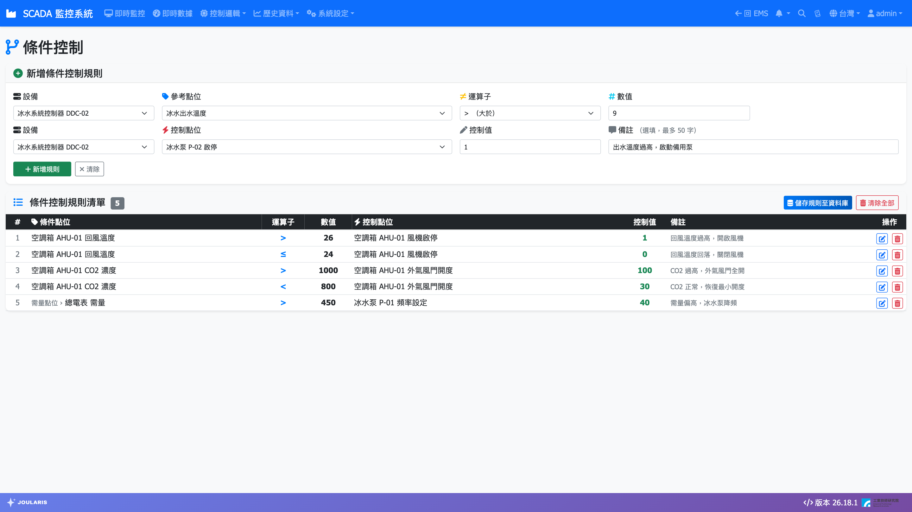
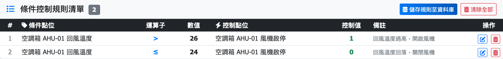

# 條件控制

**條件控制** 讓系統依據某個點位的數值，自動對另一個點位寫入控制值。每一條規則的邏輯都是：

> **如果**「條件點位」符合「運算子＋數值」，**就**把「控制值」寫入「控制點位」。

例如：「如果 水箱液位 < 20，就把 補水泵啟停 寫入 1」。

適合簡單的單一條件自動化。需要多個條件組合、計時或排程的複雜邏輯，請洽系統工程師以「流程圖控制」設計。

## 進入頁面

點導覽列 **控制邏輯 → 條件控制**。

## 畫面配置

| 區域 | 說明 |
|------|------|
| **新增條件控制規則** | 上方表單，選擇條件點位、運算子、數值，以及控制點位與控制值 |
| **條件控制規則清單** | 下方表格，列出所有規則 |
| **儲存規則至資料庫** | 清單下方的按鈕，**按下後規則才會真正生效** |

## 新增規則

1. 在 **新增條件控制規則** 表單的條件區：
   1. **設備**：選擇條件點位所在的設備；也可選 **計算點位**、**需量點位**，或保留 **— 全部設備 —** 顯示所有點位。
   2. **子設備**：若該設備底下有多台子設備，會多出此欄位，請再選一次。
   3. **參考點位**：選擇要判斷的點位。
   4. **運算子**：選擇 **>　（大於）**、**<　（小於）**、**>=　（大於等於）**、**<=　（小於等於）**、**=　（等於）** 或 **≠　（不等於）**。
   5. **數值**：輸入比較用的數值。
2. 在控制區：
   1. 同樣依序選擇 **設備**、（**子設備**）、**控制點位**。
   2. **控制值**：輸入條件成立時要寫入的數值（例如開關類寫 `1` 或 `0`）。
3. **備註**（選填，最多 50 字）：寫下規則用途，方便日後辨識。
4. 按 **新增規則**，規則會加到下方清單。
5. 確認清單內容無誤後，按 **儲存規則至資料庫**。看到「已儲存 N 筆規則」即完成。

> ⚠️ 注意：按 **新增規則** 只是把規則加進畫面上的清單，**還沒有生效**。一定要按 **儲存規則至資料庫**，系統才會開始執行。離開頁面前若沒有儲存，剛才的變更會全部遺失。

> 💡 提示：條件點位與控制點位不能是同一個點位。按 **清除** 可清空表單重新填寫。

## 修改規則

1. 在 **條件控制規則清單** 中，點該列右側的鉛筆（**編輯**）圖示。
2. 規則內容會載入上方表單，該列以黃色標示。
3. 修改欄位後，按表單上的 **編輯** 套用；按 **取消** 則放棄修改。
4. 按 **儲存規則至資料庫**。

> 💡 提示：直接點清單中的某一列（不是按鉛筆），會把該規則內容複製到表單。適合用來「以現有規則為範本」快速建立相似規則，修改後按 **新增規則** 即可。

## 刪除規則

1. 點該列右側的垃圾桶（**刪除**）圖示，規則會從清單移除。
2. 按 **儲存規則至資料庫** 使刪除生效。

要一次刪掉所有規則，可按 **清除全部**，確認後再按 **儲存規則至資料庫**。

> ⚠️ 注意：**清除全部** 後若按下 **儲存規則至資料庫**，資料庫中的所有條件控制規則都會被刪除，請謹慎操作。

## 規則如何執行

- 儲存後約 **30 秒內** 系統就會載入新規則開始執行。
- 系統約每 5 秒檢查一次所有規則。
- 同一條規則觸發寫入後，會有 **30 秒冷卻時間**，避免數值在門檻附近跳動時反覆寫入設備。
- 條件不再成立時，系統**不會**自動把控制點位改回原值。若需要「低於 20 開、高於 80 關」這類行為，請建立兩條方向相反的規則。

## 注意事項

- 規則會直接寫入現場設備，請與現場人員確認控制值的意義（例如 `1` 代表啟動還是停止）。
- 若控制點位在 [即時監控](scada-page) 被人員切到手動模式（角落有橘色 **M**），請確認現場操作與規則不會互相衝突。
- 頁面上出現「儲存失敗」時，請稍後再試；若持續失敗請通知工程師。
