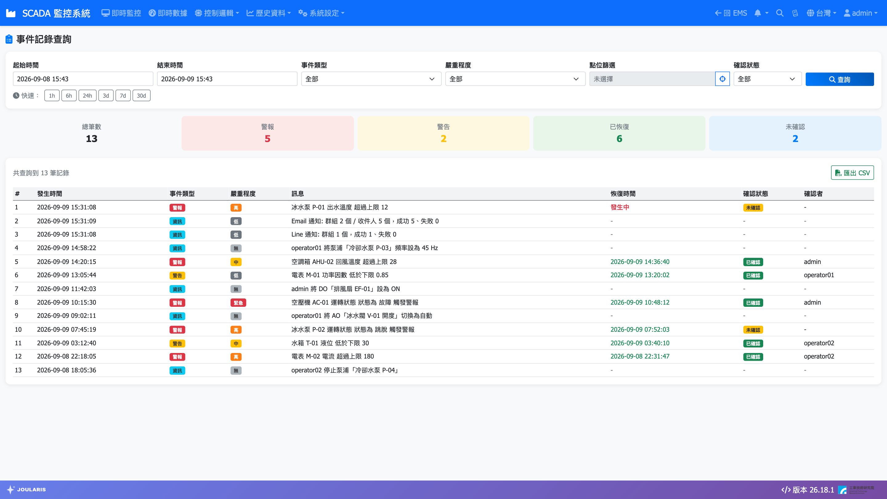
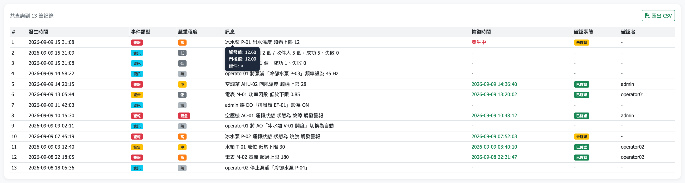

# 事件記錄

**事件記錄** 用來查詢系統過去發生的各種事件，包括：

- **警報**：點位超過上下限、DI 狀態異常的發生與恢復。
- **資訊**：人員在監控畫面上下達的控制操作（誰、何時、對哪個點、做了什麼），以及 Line／Email／簡訊通知的發送結果。
- **系統**：系統本身的狀態事件。

交接班時回顧警報、追查「是誰在什麼時候把設備切到手動」，都可以在這裡查到。

## 進入頁面

點導覽列 **歷史資料 → 事件記錄**。頁面標題為 **事件記錄查詢**。

## 畫面配置

| 區域 | 說明 |
|------|------|
| 篩選條件 | 時間、事件類型、嚴重程度、點位、確認狀態 |
| 統計數字 | 查詢結果的 **總筆數**、**警報**、**警告**、**已恢復**、**未確認** 筆數 |
| 結果表格 | 每筆事件一列 |

## 查詢事件

1. 設定 **起始時間** 與 **結束時間**；或按 **快速：** 旁的 **1h**、**6h**、**24h**、**3d**、**7d**、**30d**，自動填入從現在往回推的範圍。
2. 視需要設定其他篩選條件（不設定即為 **全部**）：
   - **事件類型**：**警報**、**警告**、**資訊**、**系統**。
   - **嚴重程度**：**緊急**、**高**、**中**、**低**、**無**。
   - **點位篩選**：只看某個點位的事件（見下一節）。
   - **確認狀態**：**未確認** 或 **已確認**。
3. 按 **查詢**。

結果上方會顯示「共查詢到 N 筆記錄」。

### 只看某個點位

1. 按 **點位篩選** 欄位旁的準心圖示，開啟 **選擇設備** 視窗。
2. 點選設備，進入 **選擇點位**；可在搜尋框輸入點位名稱縮小範圍。按 **返回** 可回到設備清單。
3. 選好點位後按 **確認**。
4. 要取消點位篩選，按欄位旁的 ✕。

## 看懂結果表格

| 欄位 | 說明 |
|------|------|
| **#** | 序號 |
| **發生時間** | 事件發生的時間 |
| **事件類型** | 警報、警告、資訊、系統，以不同顏色標籤顯示 |
| **嚴重程度** | 緊急、高、中、低、無 |
| **訊息** | 事件內容。滑鼠移到訊息上，會顯示 **觸發值**、**門檻值** 與 **條件** |
| **恢復時間** | 警報恢復正常的時間；仍未恢復者顯示紅色 **發生中** |
| **確認狀態** | **已確認** 或 **未確認** |
| **確認者** | 確認此警報的帳號 |

> 💡 提示：控制操作、通知發送結果這類「資訊」事件是一次性的紀錄，沒有恢復或確認的概念，所以 **恢復時間**、**確認狀態**、**確認者** 三欄會顯示 `-`。

### 嚴重程度的意思

| 等級 | 意思 |
|------|------|
| **緊急** | 最高優先，需立即處理 |
| **高** | 高優先 |
| **中** | 中優先 |
| **低** | 低優先，以記錄為主 |
| **無** | 控制操作等稽核紀錄，不屬於警報 |

## 確認警報要在哪裡做？

事件記錄頁是**查詢用**，無法在這裡確認警報。要確認目前發生中的警報，請到 [即時監控](scada-page) 畫面下方的 **未恢復警報** 面板，在該筆警報上雙擊。確認後，事件記錄的 **確認狀態** 與 **確認者** 會跟著更新。

## 匯出 CSV

1. 完成查詢後，按結果上方的 **匯出 CSV**。
2. 瀏覽器會下載包含目前查詢結果的 CSV 檔，可用 Excel 開啟。

## 常見狀況

| 狀況 | 處理方式 |
|------|----------|
| 出現「請選擇起始與結束時間」 | 兩個時間都必須設定，或直接按快速時間按鈕 |
| 顯示「查詢範圍內無事件記錄」 | 該時段沒有符合條件的事件，請放寬時間範圍或篩選條件 |
| 想知道某設備是誰切到手動的 | 用 **點位篩選** 選該控制點、**事件類型** 選 **資訊**，即可看到每次操作的人員與時間 |
| 警報一直顯示 **發生中** | 現場數值尚未回到正常範圍（含死區），請到現場確認；若點位已不需要警報，請管理員調整 [警報設定與通知](alarm-setting) |
