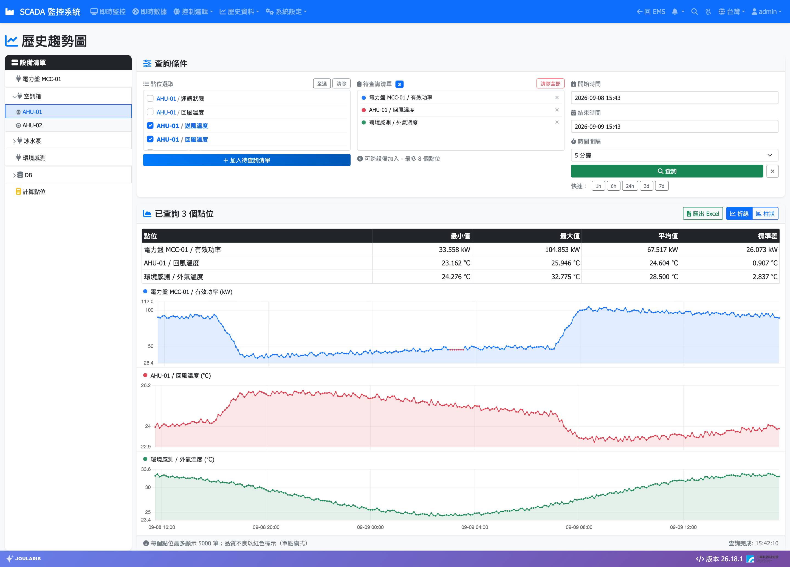
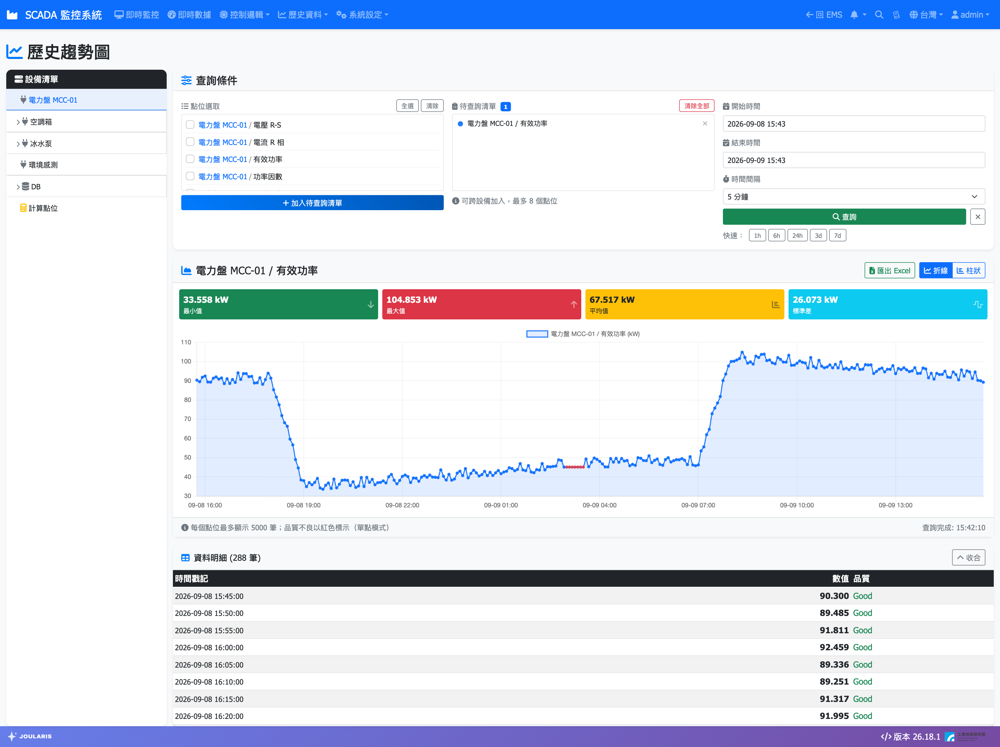

# 趨勢圖

**趨勢圖** 用來查詢點位過去一段時間的數值變化，以曲線或柱狀圖呈現，並提供最小值、最大值、平均值等統計，也可以匯出成 Excel 檔。一次最多可以比較 8 個點位。

## 進入頁面

點導覽列 **歷史資料 → 趨勢圖**。頁面標題為 **歷史趨勢圖**。

也可以從 [即時監控](scada-page) 在點位上按右鍵：

- 選 **歷史趨勢（開新頁）**：直接開新分頁，自動帶入該點位並查詢最近 1 小時。
- 選 **加入趨勢圖清單**：之後打開趨勢圖頁時，點位會自動出現在 **待查詢清單**。

## 畫面配置

| 區域 | 說明 |
|------|------|
| 左側 **設備清單** | 選擇設備，篩選要挑選的點位 |
| **查詢條件** | 分三欄：**點位選取**、**待查詢清單**、時間設定 |
| 圖表區 | 查詢結果曲線與統計 |
| **資料明細** | 只查 1 個點位時出現，列出每一筆原始數值 |

## 查詢步驟

### 1. 挑選點位

1. 在左側 **設備清單** 點選設備（有子設備時可展開再選），**點位選取** 欄會列出該設備的點位。
2. 勾選要查詢的點位。可按 **全選** 或 **清除**。
3. 按 **加入待查詢清單**，點位會移到 **待查詢清單**。
4. 重複以上步驟，可以從不同設備加入點位，最多 8 個。

**待查詢清單** 中每個點位前的色點，就是它在圖上的線條顏色。要移除單一點位按 **移除**，全部清掉按 **清除全部**。

### 2. 設定時間

1. 設定 **開始時間** 與 **結束時間**；或按 **快速：** 旁的 **1h**、**6h**、**24h**、**3d**、**7d**，自動填入「從現在往回推」的時間範圍。
2. 選擇 **時間間隔**：**1 分鐘**、**5 分鐘**、**15 分鐘**、**30 分鐘** 或 **1 小時**。間隔越大，資料點越少、長時間查詢越快。

> 💡 提示：時間間隔取的是每個區間內的**第一筆**數值，不是平均值。看細部變化請用 1 分鐘；看一週以上的趨勢建議用 15 分鐘以上。

### 3. 查詢

按 **查詢**。查詢完成後，圖表右下角會顯示 **查詢完成** 時間。

> 💡 提示：更改時間間隔或時間範圍後，必須再按一次 **查詢** 才會更新圖表。

## 看懂圖表

圖表會依點位數量自動切換顯示方式：

| 點位數 | 顯示方式 |
|--------|----------|
| 1 個 | 單一大圖，上方有統計卡片，下方有 **資料明細**；品質不良的資料點以紅色標示 |
| 2 個 | 同一張圖、左右各一個 Y 軸；可按 **雙軸** / **單軸** 切換成共用一個 Y 軸 |
| 3 個以上 | 每個點位一張小圖上下堆疊，共用時間軸 |

圖表右上角可切換 **折線** 或 **柱狀**。滑鼠移到曲線上可看到該時間點的精確數值。

### 統計數字

| 項目 | 說明 |
|------|------|
| **最小值** / **最大值** / **平均值** / **標準差** | 只用品質正常的資料計算，斷線期間的數值不列入 |
| **差異值** | 只有累計型點位（例如 kWh 電度、m³ 水量）才會出現，代表這段期間的累計用量；電表歸零或換表時系統會自動分段相加 |

多個點位時，統計以表格呈現，每個點位一列。

### 斷線期間的畫法

點位在某段時間通訊中斷（品質不良）時，曲線會沿用中斷前最後一筆正常數值，維持線條連續；單點模式下這些點會標成紅色，提醒您那段數值並非實際量測。

### 資料明細

只查 1 個點位時，圖表下方會有 **資料明細**，預設收起。按 **展開** 可看到每一筆的 **時間戳記**、**數值**、**品質**；按 **收合** 收起。

## 匯出 Excel

1. 完成查詢後，按圖表上方的 **匯出 Excel**。
2. 系統會產生並下載 Excel 檔（檔名如「歷史趨勢_20260515_0830.xlsx」）。

檔案內容包含：

- **統計** 分頁：查詢期間、時間間隔，以及每個點位的最小、最大、平均、標準差、差異值與備註。
- **圖表** 分頁：依點位類型自動產生的圖表（累計值畫長條圖／圓餅圖，即時值畫折線圖）。
- 每個點位一個資料分頁：時間戳記、數值、品質與有效值。

> ⚠️ 注意：若出現「預估 N 格，超過匯出上限…」，表示匯出資料量太大，請縮短時間範圍、減少點位，或加大時間間隔後重新查詢再匯出。

## 資料量上限

- 每個點位一次最多顯示 5000 筆。超過時會出現黃色提示「部分點位超過每點位筆數上限」，只顯示前段資料。
- 遇到這種情況，請縮短時間範圍或改用較大的 **時間間隔**。

## 常見狀況

| 訊息 | 處理方式 |
|------|----------|
| 請先將點位加入待查詢清單 | 勾選點位後要先按 **加入待查詢清單**，再按 **查詢** |
| 最多只能加入 8 個點位 | 移除部分點位，或分兩次查詢 |
| 開始時間必須早於結束時間 | 重新設定時間 |
| 該時段內無歷史資料 | 該時段點位沒有紀錄，請確認時間範圍，或確認點位當時是否已在採集 |
| 狀態類點位（只有 0 與 1）的平均值 | 平均值可視為「運轉率」，例如 0.75 代表 75% 的時間處於運轉 |
