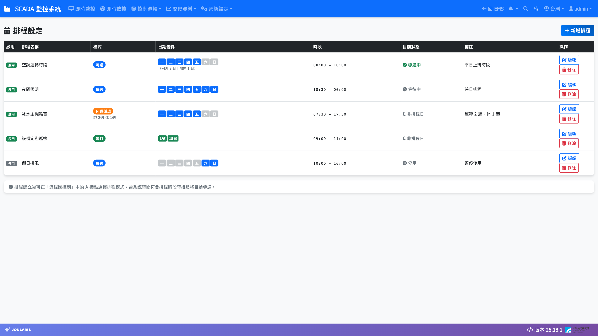
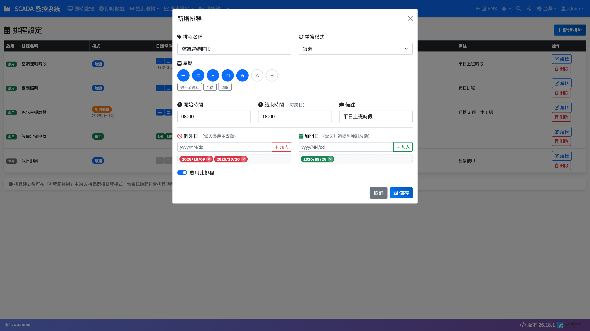

# 排程設定

**排程設定** 用來建立「什麼日子、幾點到幾點」的時間排程，例如「上班時間：週一至週五 08:00～17:00」。排程本身不會直接控制設備，而是提供一個「現在是否在排程時段內」的開／關訊號，給其他功能使用：

- 工程師在「流程圖控制」中把排程接到控制邏輯，例如排程時段內自動開啟空調。
- 監控畫面上的燈號可以顯示某個排程目前是否啟動。

因此，現場人員最常做的事是：**調整時段、加入國定假日等例外日、加入補班日等加開日**。

## 進入頁面

點導覽列 **控制邏輯 → 排程設定**。

## 排程清單

| 欄位 | 說明 |
|------|------|
| **啟用** | 排程是否啟用 |
| **排程名稱** | 例如「上班時間」 |
| **模式** | 重複模式，例如 **每週**、**N 週循環** |
| **日期條件** | 適用的星期或日期；有例外日／加開日時，下方會以灰字提示「例外 N 日｜加開 N 日」 |
| **時段** | 開始～結束時間 |
| **目前狀態** | 此刻的狀態，見下表 |
| **備註** | 說明文字 |
| **操作** | **編輯**、**刪除** |

### 目前狀態的意思

| 狀態 | 說明 |
|------|------|
| **導通中** | 現在正處於排程時段內，訊號為「開」 |
| **等待中** | 今天是排程日，但還沒到（或已過）時段 |
| **非排程日** | 今天不在排程規則內，或是例外日 |
| **停用** | 排程已停用，訊號一律為「關」 |

## 新增排程

1. 按右上角 **新增排程**。
2. 填寫 **排程名稱**（例如：上班時間）。
3. 選擇 **重複模式**（說明見下一節），並勾選對應的日期：
   - **每週** / **N 週循環**：在 **星期** 勾選一～日。可用 **週一至週五**、**全選**、**清除** 快速勾選。
   - **每月** / **N 月循環**：在 **每月幾號** 勾選日期。
4. 設定 **開始時間** 與 **結束時間**（24 小時制）。
5. 視需要加入 **例外日** 與 **加開日**（見後文）。
6. 填寫 **備註**（選填），確認已勾選 **啟用此排程**。
7. 按 **儲存**。

> 💡 提示：儲存後，使用此排程的控制邏輯最慢約 15 秒內就會套用新設定，不需要重新啟動任何服務。

## 重複模式

| 模式 | 說明 | 例子 |
|------|------|------|
| **每週** | 每週固定的星期幾 | 每週一至週五 |
| **N 週循環** | 「跑」幾週、「休」幾週交替，並在跑的週內套用星期條件 | 跑 1 週休 1 週（隔週輪班） |
| **每月** | 每月固定的幾號 | 每月 1 號、15 號 |
| **N 月循環** | 「跑」幾個月、「休」幾個月交替，並在跑的月內套用日期條件 | 跑 1 月休 2 月（每季一次） |

選擇循環模式時，需另外設定：

- **跑** 與 **休**：各為幾週（或幾月），都必須至少為 1。
- **週期起算時間**：從哪一個時間點開始計算「跑／休」交替。例如起算時間設在某個週一 00:00、跑 1 週休 1 週，就代表那一週是「跑」，下一週是「休」，依此類推。

## 跨日時段

結束時間可以早於開始時間，系統會自動視為**跨日**。例如夜班設定 **開始時間** 22:00、**結束時間** 01:00，只要一筆排程即可，不必拆成兩筆。

跨日時段以「開始那一天」判斷是否為排程日。例如「每週一 22:00～01:00」，週二凌晨 00:30 仍算週一這筆排程的延續，因此為 **導通中**；週二晚上 22:30 則不導通。

> ⚠️ 注意：開始時間與結束時間不可以相同。

## 例外日與加開日

| 項目 | 效果 | 常見用途 |
|------|------|----------|
| **例外日** | 當天整段不啟動 | 國定假日、停機日、設備檢修日 |
| **加開日** | 當天不管重複規則，強制啟動 | 補班日、活動日 |

加入方式：

1. 在編輯視窗的 **例外日** 或 **加開日** 欄位輸入日期（格式 yyyy/MM/dd，例如 2026/05/15）。
2. 按 **加入**，日期會以色塊顯示（紅色為例外日、綠色為加開日）。
3. 要移除時，點色塊上的移除符號。
4. 按 **儲存**。

同一天不能同時是例外日又是加開日。若把已在另一個清單中的日期加入，系統會詢問是否改到目前這個清單（並自動從原清單移除）。

> 💡 提示：跨日排程若遇到例外日，凌晨延續的那一段也會一起停止。例如「週一 22:00～01:00」把某個週一設為例外日，則當晚 22:00 起到隔天 01:00 都不會啟動。

## 修改、停用與刪除

- **修改**：按該列的 **編輯**，改完按 **儲存**。
- **暫停使用**：編輯後取消勾選 **啟用此排程** 再儲存，狀態會變成 **停用**，訊號一律為「關」。
- **刪除**：按 **刪除** 並確認。

> ⚠️ 注意：刪除前請先向工程師確認此排程沒有被流程圖控制或監控畫面使用，否則相關的自動控制會失去依據。監控畫面上若出現「排程不存在」，就是對應的排程已被刪除。
